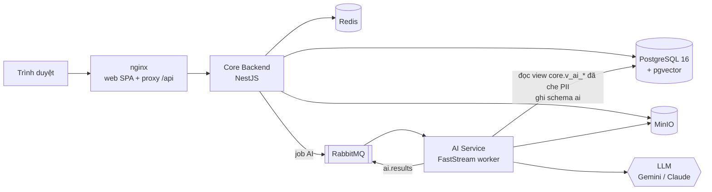

# Smart Recruit Match

Hệ thống giúp Trung tâm quan hệ doanh nghiệp của trường điều phối đợt thực tập: ghép sinh viên với doanh nghiệp theo năng lực và chỉ tiêu. LLM đọc CV và JD, chấm độ phù hợp kèm bằng chứng, sinh và chấm bài test. Thuật toán Deferred Acceptance phân bổ sinh viên vào các JD, không JD nào nhận quá sức chứa. Con người giữ quyền quyết định: HR duyệt hồ sơ và phỏng vấn, Trung tâm duyệt và điều chỉnh kết quả phân bổ.

Đây là đồ án tốt nghiệp. Ngoài sản phẩm chạy được, đồ án cần số liệu thực nghiệm cho thấy cơ chế phân bổ và các agent AI tốt hơn cách sinh viên tự nộp CV, doanh nghiệp tự lọc như hiện nay.

## Bài toán

- **Dồn hồ sơ:** sinh viên tập trung vào vài công ty "hot", trong khi công ty khác thiếu ứng viên.
- **Sàng lọc thủ công:** tốn thời gian của Trung tâm và HR, kết quả cảm tính, thiếu nhất quán.
- **CV tự khai:** khó kiểm chứng năng lực thật trước khi phỏng vấn.
- **Bị từ chối liên tiếp:** có sinh viên đến cuối đợt vẫn chưa có nơi thực tập.

## Luồng nghiệp vụ

1. HR đăng JD. AI chuẩn hóa yêu cầu (kỹ năng, mức độ, điều kiện cứng), HR xác nhận.
2. Sinh viên nộp CV. AI trích xuất hồ sơ năng lực và tách thông tin cá nhân, sinh viên xem lại và xác nhận.
3. AI chấm độ phù hợp từng cặp sinh viên × JD, kèm bằng chứng trích từ CV. Sinh viên xem shortlist và chọn tối đa 3 nguyện vọng.
4. Sinh viên làm bài test do AI sinh theo yêu cầu của JD. Mọi người dự tuyển cùng JD nhận đề tương đương.
5. Deferred Acceptance phân bổ theo điểm tổng hợp S_final và chỉ tiêu của từng JD.
6. HR duyệt danh sách đề cử, phỏng vấn, gửi lời mời. Sinh viên chưa có nơi được xét ở vòng bổ sung.

Chi tiết từng giai đoạn (GĐ0–GĐ10), công thức điểm và quy tắc nghiệp vụ BR-01…BR-18 nằm trong [PRD](docs/PRD.md).

## Nguyên tắc thiết kế

- **LLM không ra quyết định.** LLM trả JSON theo schema: verdict từng tiêu chí kèm bằng chứng. Code tính S_cv, S_test, S_final. Điều kiện cứng, chấm trắc nghiệm, phân bổ, chuyển trạng thái và phân quyền không dùng LLM.
- **Bằng chứng kiểm chứng được.** Verdict `MET`/`PARTIAL` phải có đoạn trích khớp với văn bản CV (RapidFuzz ≥ 85), nếu không thì bị hạ xuống `NOT_MET`.
- **Công bằng và dữ liệu cá nhân.** Bước chấm chỉ nhận hồ sơ đã che PII (`profile_masked`); ảnh, giới tính, ngày sinh, quê quán không vào bất kỳ bước chấm nào. CV, JD và bài làm được coi là dữ liệu chứ không phải chỉ dẫn cho LLM, và hệ thống phát hiện chữ ẩn trong file.
- **Tất định, truy vết được.** Allocation Engine là hàm TypeScript thuần, có property-based test cho ba tính chất: ổn định, không vượt sức chứa, tất định. Mọi chuyển trạng thái đi qua `transitionTo` và ghi audit. Mọi kết quả LLM lưu kèm `model` và `prompt_version`.

Toàn bộ quy tắc: [AGENTS.md › Nguyên tắc bất biến](AGENTS.md#nguyên-tắc-bất-biến).

## Kiến trúc



- **Core Backend** (`apps/api`) là nơi duy nhất ghi schema `core` và chuyển trạng thái nghiệp vụ. Các module NestJS chỉ gọi nhau qua service đã export hoặc qua event.
- **AI Service** (`ai-service`) nhận job qua RabbitMQ (payload chỉ chứa ID, xử lý idempotent theo `job_id`). Nó chỉ ghi schema `ai` và đọc `core` qua view đã che PII.
- **Contract message** định nghĩa một lần bằng Zod ở `packages/shared/contracts`, xuất JSON Schema, rồi sinh model Pydantic cho Python.

Chi tiết: [ARCHITECTURE](docs/ARCHITECTURE.md) (thành phần, DB, queue, API, bảo mật, AD-1…AD-14).

## Công nghệ

| Phần | Công nghệ |
|---|---|
| Web (`apps/web`) | React 19, TypeScript, Vite, Tailwind CSS, shadcn/ui, TanStack Query/Table, React Hook Form + Zod |
| Core Backend (`apps/api`) | NestJS 11 (TS strict), Drizzle ORM, nestjs-zod, RabbitMQ; Jest, fast-check, testcontainers |
| Dùng chung (`packages/shared`) | Zod schema, bảng chuyển trạng thái, contract message |
| AI Service (`ai-service`) | Python 3.12, FastStream, FastAPI, Pydantic v2, Jinja2; google-genai và Anthropic SDK sau `LLMClient`; embedding `BAAI/bge-m3`; pytest |
| Hạ tầng | PostgreSQL 16 + pgvector, Redis, RabbitMQ, MinIO, Mailpit; Docker Compose; GitHub Actions |

## Cấu trúc repo

```text
apps/web/            React SPA, ba cổng: sinh viên (/sv), HR (/hr), Trung tâm và Quản trị (/admin)
apps/api/            NestJS; src/modules/<module>/{api,application,domain,infrastructure}; drizzle/ là migration SQL
packages/shared/     schema Zod, trạng thái, contract message TS ↔ Python
ai-service/          agent AI (app/agents/), prompt có phiên bản (app/prompts/), LLMClient, embedding, parsing; evals/
deploy/              docker-compose.yml, nginx, .env.example
docs/                PRD, ARCHITECTURE, CONTEXT, LESSONS, story và sprint
scripts/             script dùng trong CI và hook
```

## Chạy thử bằng Docker Compose

Cần Docker Engine với Docker Compose v2 và khoảng 2 GB RAM trống.

```bash
cp deploy/.env.example deploy/.env      # rồi đổi mọi mật khẩu
docker compose -f deploy/docker-compose.yml up -d --build --wait
```

Mở http://localhost:8080. Kiểm tra sức khỏe: `curl http://localhost:8080/api/health` (Core Backend) và `curl http://localhost:8000/health` (AI Service).

**Tài khoản demo.** Lệnh `pnpm --filter @srm/api db:seed` tạo tài khoản cho bốn vai trò, mật khẩu chung mặc định `Srm-Dev-12345`. Với hệ thống chạy bằng compose, chạy lệnh này từ máy host sau `pnpm install`, với `DATABASE_URL` trỏ vào cổng PostgreSQL của compose ([SETUP › Tài khoản demo](docs/SETUP.md#tài-khoản-demo)).

| Vai trò | Email | Cổng |
|---|---|---|
| Quản trị | `admin@srm.local` | `/admin` |
| Trung tâm | `center@srm.local` | `/admin` |
| HR | `hr.alpha@srm.local`, `hr.beta@srm.local` | `/hr` |
| Sinh viên | `sv001@srm.local`, `sv002@srm.local` | `/sv` |

**Bật LLM thật.** Mặc định `LLM_PROVIDER=fixture`: hệ thống chạy được khi chưa có API key, nhưng không phân tích được CV hay JD thật. Muốn phân tích thật, đặt `LLM_PROVIDER=gemini` và `GEMINI_API_KEY` (hoặc `anthropic` và `ANTHROPIC_API_KEY`) trong `deploy/.env`, rồi chạy lại `ai-worker`. Free tier của Gemini chỉ dùng với dữ liệu giả.

Danh sách service, biến môi trường, embedding thật và cách dọn dữ liệu: [DEPLOY.md](DEPLOY.md).

## Phát triển

Cần Node.js ≥ 22.12 (`.nvmrc`), pnpm qua `corepack enable`, Python 3.12 và Docker. Các bước cài đặt sau khi clone (liên kết skill, venv của AI Service, cổng commit, biến môi trường) nằm ở [docs/SETUP.md](docs/SETUP.md).

```bash
nvm use && corepack enable && pnpm install

pnpm typecheck                     # build @srm/shared rồi tsc mọi package
pnpm lint                          # ESLint cho api, web, shared
pnpm test                          # Jest của api: unit + integration (testcontainers, cần Docker)
pnpm --filter @srm/api test:unit   # chỉ unit test, không cần Docker
pnpm depcruise                     # kiểm tra ranh giới module
pnpm --filter @srm/api dev         # API ở :3000
pnpm --filter @srm/web dev         # web ở :5173, proxy /api sang :3000

# AI Service (Windows: .venv/Scripts/ thay cho .venv/bin/)
ai-service/.venv/bin/ruff check ai-service && ai-service/.venv/bin/pytest ai-service
```

Sửa schema DB thì chạy `pnpm --filter @srm/api db:generate`; sửa contract message thì `pnpm contracts:gen`; đổi endpoint thì `pnpm api:sync`. Commit cả các file sinh ra, vì CI kiểm chúng khớp với code.

CI ([.github/workflows/ci.yml](.github/workflows/ci.yml)) chạy typecheck, lint, test (cả integration), build web, kiểm tra ranh giới module, migration khớp schema, OpenAPI khớp API, contract TS khớp Python, và ruff cùng pytest cho AI Service. Test AI Service dùng fixture, không gọi API LLM thật.

## Tài liệu

| File | Nội dung |
|---|---|
| [docs/BRIEF.md](docs/BRIEF.md) | Tóm tắt sản phẩm, đọc đầu tiên |
| [docs/PRD.md](docs/PRD.md) | Nghiệp vụ: quy trình GĐ0–GĐ10, công thức điểm, thuật toán phân bổ, vòng đời trạng thái, BR, FR, NFR, epic |
| [docs/ARCHITECTURE.md](docs/ARCHITECTURE.md) | Stack, thành phần, DB, queue, API, bảo mật, triển khai, AD-1…AD-14 |
| [docs/CONTEXT.md](docs/CONTEXT.md) | Nhật ký quyết định D-N |
| [docs/LESSONS.md](docs/LESSONS.md) | Bẫy đã gặp, đọc trước khi bắt đầu việc |
| [docs/SETUP.md](docs/SETUP.md), [DEPLOY.md](DEPLOY.md) | Cài môi trường phát triển; chạy bằng Docker Compose |
| [DESIGN.md](DESIGN.md) | Hệ thống thiết kế giao diện |
| [docs/sprints/](docs/sprints/README.md) | Epic, story, sprint, lộ trình |
| [docs/CHANGELOG.md](docs/CHANGELOG.md) | Lịch sử phát hành |
| [AGENTS.md](AGENTS.md) | Chỉ dẫn cho agent AI (Claude Code, Codex, Cursor…) và quy trình làm việc |

## Tiến độ

37 story chia thành 6 epic, dự kiến hoàn thành trong tháng 12/2026:

| Epic | Nội dung |
|---|---|
| EPIC-1 | Nền tảng: monorepo, DB lõi, đăng nhập và phân quyền, đợt thực tập, doanh nghiệp và JD, nộp CV, thông báo |
| EPIC-2 | AI cơ bản: hạ tầng job AI, `LLMClient`, JD Analyzer, CV Parser, embedding và danh mục kỹ năng, sinh viên xác nhận hồ sơ |
| EPIC-3 | Matching: điều kiện cứng, S_cv, shortlist, chọn nguyện vọng, mức cạnh tranh |
| EPIC-4 | Thi: sinh đề và Validator, phòng thi, chấm bài, S_test và S_final, phúc khảo |
| EPIC-5 | Phân bổ và HR: Allocation Engine, vòng phân bổ, HR duyệt, phỏng vấn, lời mời, vòng bổ sung |
| EPIC-6 | Đánh giá: dashboard, chi phí LLM, bộ đánh giá AI, mô phỏng so với baseline, báo cáo, dữ liệu demo |

Tại v0.12.0, EPIC-1 và EPIC-2 đã xong. Trạng thái từng story xem ở [STATUS.md](docs/sprints/STATUS.md); phiên bản hiện tại ở [VERSION](VERSION).

## Quy trình đóng góp

Mỗi việc là một story trong `docs/sprints/stories/`. Mỗi story đi qua các bước Plan → Execute → Self-verify → Review → Doc/Version gate → Commit (chi tiết ở [AGENTS.md › Quy trình làm việc](AGENTS.md#quy-trình-làm-việc)). Commit ship code phải tăng `VERSION` và thêm mục CHANGELOG trong cùng commit. Commit message viết tiếng Anh, có prefix (`feat:`, `fix:`, `docs:`…) và mã story (US-x.y). Code và comment viết tiếng Anh; tài liệu và chuỗi giao diện viết tiếng Việt.
