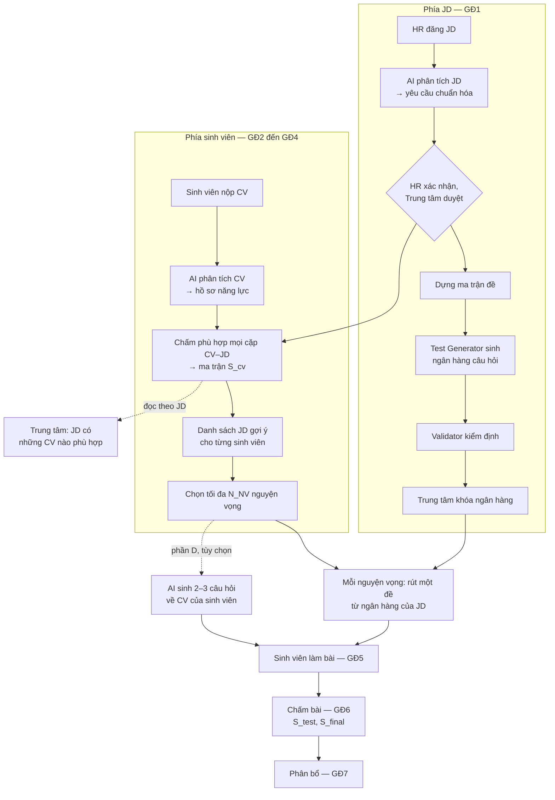
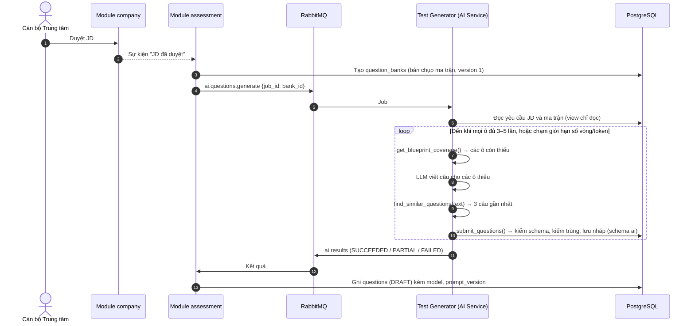
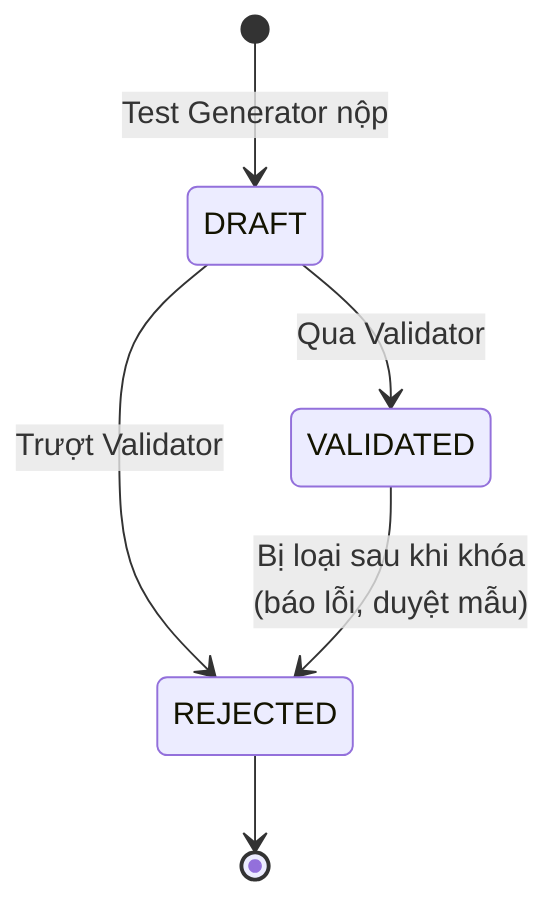

# Thiết kế sinh bài test — Smart Recruit Match

| | |
|---|---|
| Ngày | 15/10/2026 |
| Cập nhật | 23/10/2026 (bản 0.9.0): thêm [mục 15](#15-demo-từ-một-cặp-jd-và-cv-đến-đề-thi), demo một cặp JD–CV từ phân tích đến đề thi; thêm điểm cần chốt số 11. 25/10/2026: thêm [mục 1.1](#11-chấm-phù-hợp-và-danh-sách-jd-gợi-ý-cho-sinh-viên), chấm phù hợp mọi cặp CV–JD và danh sách JD gợi ý cho sinh viên; mở rộng [mục 15.5](#155-bước-3-chấm-phù-hợp-và-danh-sách-jd-gợi-ý-us-31-đến-us-34) thành ma trận 4 sinh viên × 5 JD; thêm điểm cần chốt số 12, đã chốt cùng ngày và đưa vào PRD (CONTEXT D36) |
| Phiên bản hệ thống | 0.5.0 |
| Phạm vi | GĐ5–GĐ6: sinh ngân hàng câu hỏi, rút đề, câu hỏi xác minh CV, chấm điểm. Phần GĐ3–GĐ4 (chấm phù hợp, danh sách JD gợi ý) chỉ trình bày đủ để nối vào bài test |
| Trạng thái | Thiết kế, chưa cài đặt. Story US-4.1…US-4.9, dự kiến tuần T7–T10 (16/11–13/12) |
| Tài liệu gốc | [PRD › GĐ3–GĐ6](../docs/PRD.md), [ARCHITECTURE › AI Service](../docs/ARCHITECTURE.md), story [US-3.3](../docs/sprints/stories/US-3.3-shortlist-and-preferences.md), [US-4.1](../docs/sprints/stories/US-4.1-exam-blueprint-test-generator.md), [US-4.2](../docs/sprints/stories/US-4.2-validator-and-question-bank-lock.md), [US-4.3](../docs/sprints/stories/US-4.3-exam-room.md), [US-4.4](../docs/sprints/stories/US-4.4-grading-stest-sfinal.md), [US-4.8](../docs/sprints/stories/US-4.8-cv-verification-questions-trust-score.md) |

## Tóm tắt

- **Bài test không được LLM sinh riêng cho từng cặp CV–JD.** Mỗi JD có một ngân hàng câu hỏi, sinh **một lần** ngay khi JD được duyệt. Lúc đó CV có thể còn chưa match. Khi sinh viên đã chọn nguyện vọng (NV) và bấm bắt đầu thi, hệ thống **rút một đề riêng** từ ngân hàng cho NV đó. Vì vậy mỗi cặp sinh viên–JD có đề riêng, và mọi đề của cùng một JD **tương đương nhau**.
- **Chấm phù hợp thì vẫn rà mọi cặp CV–JD** ([mục 1.1](#11-chấm-phù-hợp-và-danh-sách-jd-gợi-ý-cho-sinh-viên)). Kết quả là một ma trận S_cv. Đọc theo JD, Trung tâm biết JD đó có những CV nào phù hợp. Đọc theo sinh viên, mỗi sinh viên nhận **danh sách JD gợi ý** sắp theo S_cv. Sinh viên chọn nguyện vọng trong danh sách này, và mỗi nguyện vọng là một bài test.
- **CV chỉ ảnh hưởng tới phần D**: 2–3 câu hỏi về dự án mà sinh viên tự khai. Phần này **không tính điểm**. Nó chỉ tạo ra "chỉ số tin cậy CV" để HR tham khảo.
- **Đề xuất mới:** ma trận đề có thêm cấp **nhóm kỹ năng**, gồm Chuyên môn, Tư duy thuật toán và Kỹ năng mềm. Tỷ trọng nhóm quyết định số câu của nhóm đó. Công thức S_test giữ nguyên.
- **LLM làm ba việc:** sinh câu hỏi, kiểm định câu hỏi, chấm tự luận theo rubric. Code làm phần còn lại: rút đề, chấm trắc nghiệm, cộng điểm, tính S_test và S_final.
- **Chi phí** khoảng 2,9 USD cho mỗi JD và không tăng theo số sinh viên. Phương án sinh phần tính điểm riêng cho từng CV đã được cân nhắc và bị loại ([mục 10](#10-so-sánh-hai-phương-án-cá-nhân-hóa)).
- **Demo** ([mục 15](#15-demo-từ-một-cặp-jd-và-cv-đến-đề-thi)): một JD Backend và một CV giả đi qua đủ các bước, từ phân tích JD, phân tích CV, chấm phù hợp (S_cv = 76,47), danh sách 3 JD gợi ý cho sinh viên trong đợt có 5 JD, dựng ma trận đề (8/9/3 câu Dễ/Trung bình/Khó), tới đề thi hoàn chỉnh 20 + 3 + 3 câu. Ở bản 0.9.0 mới chạy thật được bước phân tích JD; các bước sau được tính theo đúng công thức của spec.

> Các mục ghi **(đề xuất)** chưa có trong PRD và story. Nhóm kỹ năng và một số tên trường thuộc loại này. Spec sẽ được cập nhật sau khi chốt các điểm ở [mục 13](#13-điểm-cần-chốt).

---

## 1. Bài test nằm ở đâu trong luồng



Mỗi việc chạy theo một đơn vị riêng:

| Việc | Đơn vị | Thời điểm | Ai làm |
|---|---|---|---|
| Dựng ma trận đề | Mỗi JD | Khi JD được duyệt | Code đề xuất, Trung tâm sửa |
| Sinh ngân hàng câu hỏi | Mỗi JD (hoặc mỗi nhóm vị trí, Q2) | Ngay sau đó, chạy nền | LLM: Test Generator |
| Kiểm định, khóa ngân hàng | Mỗi ngân hàng | Trước khi mở pha *Làm test* | LLM: Validator; Trung tâm khóa |
| Chấm phù hợp, lập danh sách JD gợi ý | Mỗi cặp sinh viên–JD, cả đợt chạy một lượt | Khi hết hạn nộp CV | LLM: Matching Agent trả verdict; code tính S_cv và lập danh sách |
| Rút đề | Mỗi NV (cặp sinh viên–JD) | Khi sinh viên bấm bắt đầu | Code |
| Câu hỏi xác minh CV (phần D) | Mỗi NV | Khi NV chuyển sang *Chờ làm test* | LLM |
| Chấm trắc nghiệm | Mỗi bài | Khi nộp bài | Code |
| Chấm tự luận | Mỗi câu tự luận | Sau khi đóng pha thi | LLM: Grader, chấm 2 lần |

**Nghĩa là:** khi CV và JD đã match xong, ngân hàng câu hỏi của JD đã có sẵn. Bước gắn với từng cặp là rút đề. Bước này không gọi LLM, nên sinh viên bấm bắt đầu là có đề ngay.

### 1.1. Chấm phù hợp và danh sách JD gợi ý cho sinh viên

Đề thi không sinh theo cặp, nhưng **chấm phù hợp thì vẫn chạy theo từng cặp**. Khi hết hạn nộp CV, hệ thống rà mọi cặp (sinh viên, JD) trong đợt (PRD › GĐ3, US-3.1, US-3.2):

1. **Lọc điều kiện cứng** bằng luật: ngành, năm học, GPA tối thiểu, ngoại ngữ bắt buộc. Cặp không đạt được ghi lý do và không gửi LLM.
2. **Lọc sơ bộ bằng embedding.** Mỗi CV chỉ giữ M JD gần nhất theo cosine (`campaigns.config.match_top_m`, mặc định 10). Đợt có ít hơn M JD thì bước này không loại cặp nào.
3. **Matching Agent** trả verdict từng tiêu chí, kèm bằng chứng trích từ CV. Code kiểm tra trích dẫn rồi tính S_cv.

Kết quả là một **ma trận S_cv** lưu ở bảng `match_results`: mỗi hàng là một sinh viên, mỗi cột là một JD. Ma trận này được đọc theo hai chiều:

| Đọc theo | Câu hỏi | Ai xem | Dùng để |
|---|---|---|---|
| Cột (theo JD) | JD này có những CV nào phù hợp? Bao nhiêu CV đạt θ_cv so với chỉ tiêu? | Cán bộ Trung tâm. HR không thấy cho tới khi có đề cử (BR-11) | Phát hiện sớm JD thiếu CV phù hợp để liên hệ doanh nghiệp, trước khi sinh viên chọn nguyện vọng (PRD › GĐ3 bước 5, FR-38; đã chốt ở điểm số 12) |
| Hàng (theo sinh viên) | CV của tôi hợp với những JD nào? | Sinh viên, chỉ thấy dữ liệu của mình | **Danh sách JD gợi ý** (shortlist, US-3.3) để chọn nguyện vọng |

**Danh sách JD gợi ý** (PRD › GĐ3 bước 3–4, GĐ4):

- Gồm các JD mà sinh viên đạt điều kiện cứng và có S_cv ≥ θ_cv (mặc định 50), sắp giảm dần theo S_cv. Danh sách do hàm thuần `selectShortlist` lập. LLM không chọn và không xếp hạng JD; nó chỉ trả verdict từng tiêu chí (AD-2).
- Mỗi JD kèm S_cv, thành phần điểm, bằng chứng, kỹ năng còn thiếu và gợi ý cải thiện. Nhờ vậy sinh viên biết vì sao JD được gợi ý (NFR-4).
- JD không đạt điều kiện cứng hiện ở mục riêng kèm lý do và không chọn được. JD đạt điều kiện nhưng S_cv < θ_cv không hiện. Cặp bị loại ở bước lọc top-M không có S_cv nên cũng không hiện.
- Khi chọn nguyện vọng, mỗi JD có thêm mức cạnh tranh (số NV / chỉ tiêu) và nhãn "Phù hợp – ít cạnh tranh" (US-3.4).
- Sinh viên chọn tối đa N_NV = 3 JD **trong danh sách này** (BR-04). Sinh viên không chọn thì hệ thống tự gán N_NV JD có S_cv cao nhất (Q6).

**Liên hệ với bài test:**

- Danh sách gợi ý quyết định sinh viên thi **những JD nào**: mỗi NV một bài, tối đa N_NV bài. Danh sách không quyết định **câu hỏi nào** có trong đề, vì ngân hàng của JD sinh từ yêu cầu JD, trước khi chấm phù hợp.
- S_cv của cặp đi tiếp vào S_final (α = 0,4). JD có S_cv < θ_cv không vào danh sách, nên sinh viên không thi và không được đề cử vào JD đó (BR-07).
- Chấm phù hợp chạy một lượt cho cả đợt qua Message Batches, khoảng 115 USD với 500 sinh viên × 50 JD (US-3.2). Khoản này tách khỏi chi phí sinh đề ở [mục 11](#11-chi-phí).

Ví dụ với 4 sinh viên và 5 JD, cả hai chiều đọc: [mục 15.5](#155-bước-3-chấm-phù-hợp-và-danh-sách-jd-gợi-ý-us-31-đến-us-34).

---

## 2. Nguyên tắc

| Nguyên tắc | Nội dung | Nguồn |
|---|---|---|
| Đề tương đương | Mọi sinh viên dự tuyển cùng một JD làm cùng ma trận đề: cùng phân bố kỹ năng × độ khó, cùng số câu, cùng thời gian. Chỉ câu hỏi cụ thể là khác nhau. Phần tính điểm không cá nhân hóa theo CV, để điểm của các sinh viên so sánh được với nhau | BR-05 |
| Chi phí không tăng theo số sinh viên | Mỗi JD sinh ngân hàng một lần. Không sinh câu riêng cho từng sinh viên | NFR-11 |
| LLM không tính điểm | LLM sinh câu, kiểm định câu và chấm tự luận theo từng tiêu chí của rubric. Code chấm trắc nghiệm, cộng điểm, tính S_test và S_final | AD-2, D2 |
| Đáp án không rời server | Client chỉ nhận đề và phương án đã xáo. Mã phương án đổi theo từng phiên thi | AGENTS › Nguyên tắc 8 |
| Không dùng dữ liệu nhạy cảm | Phần D chỉ đọc hồ sơ đã che thông tin cá nhân | BR-03 |
| Truy vết | Mỗi câu hỏi lưu kèm model và phiên bản prompt. Sau khi khóa ngân hàng, mọi thay đổi đều tăng phiên bản | D12 |

---

## 3. Cấu trúc đề

Cấu trúc mặc định, cấu hình được theo từng JD:

| Phần | Nội dung | Tính vào S_test |
|---|---|---|
| A. Trắc nghiệm | 20 câu, 4 phương án, đúng 1 đáp án, phủ các kỹ năng của JD | 60% |
| B. Tự luận ngắn, tình huống | 2–3 câu: giải thích khái niệm, xử lý tình huống, thiết kế đơn giản | 40% |
| C. Lập trình | 1 bài, chấm bằng test case trong sandbox | Ngoài phạm vi bản chính (Q7) |
| D. Xác minh CV (tùy chọn) | 2–3 câu về dự án và kỹ năng sinh viên khai trong CV | Không tính. Chỉ tạo chỉ số tin cậy CV |

---

## 4. Ma trận đề: nhóm → kỹ năng → độ khó (đề xuất)

Ma trận đề trong spec hiện tại có hai chiều là **kỹ năng × độ khó**. Kỹ năng lấy từ yêu cầu chuẩn hóa của JD, nên chủ yếu là kỹ năng kỹ thuật. Đề xuất thêm một cấp **nhóm kỹ năng** ở trên, để đề đo được cả tư duy thuật toán và kỹ năng mềm.

### 4.1. Ba nhóm kỹ năng

| Nhóm (mã) | Nguồn kỹ năng | Dạng câu phần A | Dạng câu phần B |
|---|---|---|---|
| Chuyên môn (`TECHNICAL`) | Kỹ năng trong yêu cầu JD mà HR đã xác nhận (US-2.3) | Câu hỏi kiến thức, đọc đoạn code, chọn cách làm đúng | Giải thích khái niệm, thiết kế đơn giản (VD thiết kế API) |
| Tư duy thuật toán (`PROBLEM_SOLVING`) | Danh mục kỹ năng chung, cấu hình theo đợt. VD: Cấu trúc dữ liệu và giải thuật, Độ phức tạp, Tư duy logic | Đọc pseudo-code rồi đoán kết quả, chọn cấu trúc dữ liệu, so sánh độ phức tạp | Mô tả lời giải cho một bài toán nhỏ và phân tích độ phức tạp. Phần C chấm code tự động nằm ngoài phạm vi (Q7) |
| Kỹ năng mềm (`SOFT_SKILL`) | Danh mục kỹ năng chung. VD: Giao tiếp, Làm việc nhóm, Quản lý thời gian | Trắc nghiệm tình huống (SJT): chọn cách xử lý tốt nhất, kèm giải thích | Xử lý một tình huống, chấm theo rubric |

### 4.2. Ví dụ: JD "Thực tập sinh Backend Java"

Phần A, 20 câu:

| Nhóm | Tỷ trọng nhóm | Kỹ năng | Dễ | Trung bình | Khó | Cộng |
|---|---|---|---|---|---|---|
| Chuyên môn | 60% | Java core, OOP | 1 | 2 | 1 | 4 |
| | | Spring Boot, REST API | 1 | 2 | 1 | 4 |
| | | SQL, cơ sở dữ liệu | 2 | 1 | 1 | 4 |
| Tư duy thuật toán | 25% | Cấu trúc dữ liệu và giải thuật | 2 | 2 | 1 | 5 |
| Kỹ năng mềm | 15% | Giao tiếp | 1 | 1 | 0 | 2 |
| | | Làm việc nhóm | 1 | 0 | 0 | 1 |
| **Tổng** | 100% | | **8** | **8** | **4** | **20** |

Phần B, 3 câu, mỗi nhóm một câu: một câu thiết kế REST API (Chuyên môn), một câu mô tả lời giải (Tư duy thuật toán), một câu xử lý tình huống trong nhóm (Kỹ năng mềm).

### 4.3. Cách chia số câu

Hàm thuần `buildDefaultBlueprint()` (US-4.1) chia số câu phần A theo ba bước:

1. **Chia cho các nhóm** theo tỷ trọng nhóm: 20 × 60% / 25% / 15% = **12 / 5 / 3**.
2. **Chia cho các kỹ năng trong nhóm** theo trọng số kỹ năng. Nhóm Chuyên môn lấy trọng số mà HR đã xác nhận. Hai nhóm còn lại lấy trọng số cấu hình.
3. **Chia cho các mức độ khó** của từng kỹ năng.

Mỗi bước dùng cách làm tròn **phần dư lớn nhất**. Trước hết mỗi phần nhận phần nguyên của số câu. Số câu còn thừa lần lượt chia cho các phần có phần thập phân lớn nhất. Nếu hòa thì xét theo mã nhóm, rồi tới tên kỹ năng. Cách này luôn ra cùng một kết quả với cùng một đầu vào, và tổng số câu luôn đúng.

| Bước | Đầu vào | Tính | Kết quả |
|---|---|---|---|
| Nhóm Chuyên môn, 12 câu | Trọng số Java 0,35; Spring 0,35; SQL 0,30 | 4,2 / 4,2 / 3,6 → phần nguyên 4 / 4 / 3, còn thừa 1 câu, chia cho SQL (phần dư 0,6 lớn nhất) | 4 / 4 / 4 |
| Nhóm Kỹ năng mềm, 3 câu | Giao tiếp 0,5; Làm việc nhóm 0,5 | 1,5 / 1,5 → 1 / 1, còn thừa 1 câu, phần dư bằng nhau nên xét theo tên | 2 / 1 |

Các ô Dễ/Trung bình/Khó trong bảng ở mục 4.2 được điền tay để minh họa. Cách chia độ khó cho kỹ năng chỉ có vài câu vẫn là điểm cần chốt: với 4 câu, làm tròn có thể làm mất hẳn câu khó ([mục 13](#13-điểm-cần-chốt)). Trung tâm xem và sửa được ma trận trước khi khóa ngân hàng.

### 4.4. Tỷ trọng nhóm và điểm

- **Tỷ trọng nhóm chỉ quyết định số câu.** S_test vẫn là `0,6 × A + 0,4 × B`. Câu trắc nghiệm nào cũng có cùng điểm, nên nhóm có nhiều câu hơn sẽ đóng góp nhiều điểm hơn. Không cần thêm một lớp trọng số nữa.
- Điểm theo nhóm hiện trên **bản đồ năng lực** cho HR ([mục 9](#9-chấm-điểm-và-bản-đồ-năng-lực)).
- Danh sách nhóm, tỷ trọng mặc định và danh mục kỹ năng chung là tham số cấu hình (đề xuất `campaigns.config.exam_skill_groups`). Trung tâm sửa theo từng JD. Đặt tỷ trọng bằng 0 là tắt nhóm đó.
- BR-05 vẫn giữ, vì mọi sinh viên của cùng một JD dùng chung một ma trận, kể cả phần nhóm.

---

## 5. Sinh ngân hàng câu hỏi theo JD

### 5.1. Kích thước ngân hàng

Mỗi ô của ma trận (nhóm × kỹ năng × độ khó) có số câu **gấp 3–5 lần** số câu cần rút. Với ví dụ trên, ngân hàng có 60–100 câu trắc nghiệm và 9–15 câu tự luận. Lý do sinh dư:

- Mỗi sinh viên rút được một tổ hợp khác nhau, nên khó lộ đề.
- Còn đủ câu dự phòng khi Validator loại câu hoặc sinh viên báo lỗi câu.

### 5.2. Luồng sinh



- Message chỉ chứa ID. Nhận trùng sự kiện hay trùng message cũng không tạo thêm ngân hàng hay câu hỏi.
- Test Generator là **agent duy nhất có vòng lặp công cụ** trong bản chính. Các agent khác chỉ gọi LLM một lượt. Lý do: phải lặp mới biết ô nào còn thiếu và câu nào trùng.
- Công cụ của agent chỉ ghi được câu nháp vào schema `ai`. Bảng nghiệp vụ `questions` (schema `core`) do backend ghi (AD-4).
- Gọi qua `LLMClient`, `effort: high`, kiểm tra `stop_reason == "refusal"` trước khi đọc kết quả. Prompt nằm ở `ai-service/app/prompts/test_generator/v1.md`.
- Chạm giới hạn mà vẫn còn ô thiếu thì trả `PARTIAL` kèm danh sách ô thiếu, không lặp vô hạn.

### 5.3. Nội dung một câu hỏi

Tên trường dưới đây là **đề xuất**. Trường `group` là phần mới.

**Trắc nghiệm, nhóm Tư duy thuật toán**

```json
{
  "type": "MULTIPLE_CHOICE",
  "group": "PROBLEM_SOLVING",
  "skill": "Cấu trúc dữ liệu và giải thuật",
  "difficulty": "MEDIUM",
  "content": {
    "stem": "Cần kiểm tra rất nhiều lần xem một mã sinh viên đã có trong danh sách 100.000 mã hay chưa. Cấu trúc dữ liệu nào phù hợp nhất?",
    "options": [
      { "key": "A", "text": "Mảng chưa sắp xếp, duyệt tuần tự" },
      { "key": "B", "text": "Bảng băm (HashSet)" },
      { "key": "C", "text": "Danh sách liên kết đơn" },
      { "key": "D", "text": "Ngăn xếp (Stack)" }
    ]
  },
  "answer_key": { "correct": "B" },
  "explanation": "Bảng băm tra cứu trung bình O(1). Mảng chưa sắp xếp và danh sách liên kết cần O(n). Ngăn xếp không hỗ trợ tra cứu."
}
```

**Trắc nghiệm tình huống (SJT), nhóm Kỹ năng mềm**

```json
{
  "type": "MULTIPLE_CHOICE",
  "group": "SOFT_SKILL",
  "skill": "Làm việc nhóm",
  "difficulty": "EASY",
  "content": {
    "stem": "Còn hai ngày đến hạn nộp, bạn phát hiện phần việc của một thành viên có lỗi làm hỏng chức năng chung. Bạn nên làm gì trước tiên?",
    "options": [
      { "key": "A", "text": "Tự sửa phần đó mà không báo ai" },
      { "key": "B", "text": "Báo trưởng nhóm rằng thành viên đó làm sai" },
      { "key": "C", "text": "Trao đổi trực tiếp với thành viên đó, chỉ ra lỗi và cùng thống nhất cách sửa kịp hạn" },
      { "key": "D", "text": "Chờ buổi họp tuần sau rồi nêu vấn đề" }
    ]
  },
  "answer_key": { "correct": "C" },
  "explanation": "C giải quyết đúng người, kịp thời và giữ tinh thần hợp tác. A bỏ qua giao tiếp. B đẩy vấn đề lên khi chưa trao đổi. D trễ hạn."
}
```

**Tự luận, nhóm Chuyên môn**

```json
{
  "type": "ESSAY",
  "group": "TECHNICAL",
  "skill": "Spring Boot, REST API",
  "difficulty": "MEDIUM",
  "content": {
    "stem": "Thiết kế các endpoint REST cho chức năng quản lý đơn hàng (tạo, xem, hủy). Nêu phương thức HTTP, đường dẫn, mã trạng thái trả về, và cách xử lý khi hủy một đơn đã giao."
  },
  "rubric": [
    { "criterion": "Phương thức và đường dẫn đúng chuẩn REST", "max_points": 3 },
    { "criterion": "Mã trạng thái phù hợp từng tình huống (201, 200, 404, 409)", "max_points": 3 },
    { "criterion": "Xử lý hợp lý nghiệp vụ hủy đơn đã giao", "max_points": 2 },
    { "criterion": "Trình bày rõ ràng", "max_points": 2 }
  ],
  "sample_answer": "POST /orders → 201; GET /orders/{id} → 200 hoặc 404; POST /orders/{id}/cancel → 200; đơn đã giao → 409 kèm lý do…"
}
```

Khi lưu, mỗi câu có thêm `status`, `model` và `prompt_version`.

### 5.4. Code kiểm tra trước khi nhận câu

Công cụ `submit_questions` kiểm tra từng câu trong lô:

- **Đúng schema.** Câu trắc nghiệm có đủ 4 phương án, đúng 1 đáp án đúng và có giải thích. Câu tự luận có rubric ghi điểm tối đa từng tiêu chí và có đáp án mẫu.
- **Đúng ma trận.** Nhóm, kỹ năng và độ khó của câu phải có trong ma trận.
- **Không trùng.** Câu bị loại với lý do `DUPLICATE` nếu trùng nguyên văn (sau khi chuẩn hóa khoảng trắng và chữ hoa/thường) hoặc nếu độ tương đồng embedding với một câu đã có ≥ 0,9 (tham số).

Câu bị loại được trả về cho agent kèm lý do, để agent viết lại. Các câu hợp lệ trong cùng lô vẫn được lưu.

---

## 6. Kiểm định và khóa ngân hàng



1. **Validator tự giải lại.** Mỗi lượt gọi là một hội thoại mới, không thấy hội thoại của Generator. Validator chỉ nhận đề và phương án, không nhận đáp án. Nó tự giải, rồi trả verdict cho từng mục checklist (`effort: high`).
2. **Code quyết định.** Code so đáp án Validator tự giải với `answer_key`. Câu trượt mục nào bị loại với mã lý do tương ứng:

    | Mã lý do (đề xuất) | Nghĩa |
    |---|---|
    | `ANSWER_MISMATCH` | Đáp án Validator tự giải khác đáp án của Generator |
    | `MULTIPLE_CORRECT` | Có hơn một phương án đúng |
    | `WEAK_DISTRACTORS` | Phương án nhiễu quá dễ loại |
    | `OFF_SKILL` | Câu không đúng kỹ năng được gắn |
    | `DIFFICULTY_MISMATCH` | Độ khó thực tế lệch nhãn |
    | `ANSWER_LEAKED` | Đề để lộ đáp án |
    | `DUPLICATE` | Trùng với câu đã có |
    | `VALIDATOR_REFUSAL` | LLM từ chối xử lý |

    Câu SJT kỹ năng mềm cần thêm một mục kiểm tra (đề xuất): có đúng một phương án tốt nhất và lý do chọn phương án đó giải thích được.
3. **Sinh bù.** Ô nào thiếu câu sau khi loại thì Generator sinh thêm cho đúng ô đó. Bước này chỉ đếm câu `VALIDATED`. Chạm số vòng tối đa thì trả `PARTIAL`.
4. **Duyệt mẫu (tùy chọn, US-4.9).** HR hoặc giảng viên duyệt một mẫu ngẫu nhiên, lấy phân tầng theo ma trận.
5. **Khóa.** Trung tâm chỉ khóa được khi mọi ô có ít nhất 3 lần số câu cần ở trạng thái `VALIDATED`. Sau khi khóa:
    - Trigger trong DB chặn mọi lệnh sửa nội dung, đáp án và rubric.
    - Chỉ còn cách loại câu bằng chuyển trạng thái. Mỗi lần loại câu, phiên bản ngân hàng tăng 1 và có ghi nhật ký.

---

## 7. Rút đề cho từng cặp sinh viên–JD

Đây là bước gắn với từng NV. Sinh viên chỉ bắt đầu thi được khi đủ ba điều kiện: NV đang ở *Chờ làm test*, đợt đang ở pha *Làm test*, và ngân hàng đã khóa.

1. Sinh viên bấm bắt đầu. Web gọi `POST /api/preferences/{id}/exam/start`.
2. Server sinh `seed`, rồi rút ngẫu nhiên **đúng số câu của từng ô** từ các câu `VALIDATED`, không câu nào lặp.
3. Server xáo thứ tự câu và thứ tự phương án. Mã phương án đổi theo từng phiên, nên không suy ra được vị trí gốc.
4. Server lưu `exam_sessions` gồm `seed`, `question_ids`, `started_at`, `deadline_at = started_at + T_test`. Deadline cũng được ghi vào Redis.
5. Server trả về đề (không có đáp án), `deadline_at` và giờ server.

**Ví dụ.** Hai sinh viên A và B cùng dự tuyển JD Backend Java. Cả hai đều có 4 câu Java (1 dễ, 2 trung bình, 1 khó), 5 câu thuật toán, 3 câu kỹ năng mềm…, cùng 3 câu tự luận và cùng thời gian. Nhưng câu hỏi cụ thể và thứ tự của hai người khác nhau.

| Tính chất | Cách bảo đảm |
|---|---|
| Đề tương đương (BR-05) | Property test (fast-check) với nhiều seed và nhiều ngân hàng: mọi đề có cùng số câu mỗi ô, cùng số câu phần B, cùng thời gian. Hàm rút đề không nhận dữ liệu CV |
| Tái lập được | Cùng `seed` và cùng phiên bản ngân hàng luôn cho cùng đề, cùng thứ tự. Dùng cho phúc khảo và truy vết |
| Mỗi NV thi một lần (BR-06) | Gọi bắt đầu lần nữa khi đang làm thì nhận lại phiên cũ. Đã nộp thì nhận `409 EXAM_ALREADY_TAKEN`. DB có ràng buộc unique `(student_id, bank_id)` |
| Dùng chung theo nhóm vị trí (Q2) | Tham số `share_exam_by_position_group`, mặc định tắt. Khi bật, các NV dùng chung một ngân hàng sẽ dùng chung một phiên thi |

Trong lúc làm bài: bài làm tự lưu mỗi lần đổi đáp án và mỗi 30 giây. Mất mạng thì làm tiếp trong thời gian còn lại. Hết giờ thì server tự đóng bài. Chuyển tab và thoát toàn màn hình được ghi lại, nhưng **chỉ để cảnh báo**, không tự đánh trượt.

---

## 8. Phần D: câu hỏi xác minh CV

Đây là **chỗ duy nhất** đề thi được cá nhân hóa theo CV (US-4.8, tùy chọn theo JD).

1. NV chuyển sang *Chờ làm test*. Backend gửi job `ai.cv_verification.generate {job_id, preference_id}` (đề xuất).
2. Agent đọc hồ sơ đã che thông tin cá nhân và yêu cầu JD, rồi sinh 2–3 câu. Mỗi câu gắn với một mục cụ thể mà sinh viên đã khai (`claim_ref`). Gọi với `effort: medium` và structured output.
3. Trong phòng thi, phần D hiện thành mục riêng có nhãn **"Không tính điểm"**.
4. Sau khi đóng phiên, LLM đối chiếu câu trả lời với CV. Mỗi câu nhận một nhận định `CONSISTENT` / `PARTIAL` / `INCONSISTENT` / `NO_ANSWER`, kèm trích dẫn. Trích dẫn không khớp câu trả lời (RapidFuzz < 85) thì nhận định bị hạ xuống.
5. Code tính chỉ số tin cậy: quy nhận định thành 1 / 0,5 / 0, lấy trung bình, rồi chia mức Cao / Trung bình / Thấp. HR thấy chỉ số này để tham khảo.

**Ví dụ.** CV ghi: "Xây dựng API đặt vé bằng Spring Boot, dùng Redis làm cache". Câu hỏi sinh ra: "Trong dự án đặt vé, bạn dùng Redis để cache dữ liệu gì, và xử lý thế nào khi dữ liệu trong DB thay đổi?"

- Sinh câu lỗi hoặc LLM từ chối thì NV đó không có phần D. Sinh viên vẫn thi bình thường.
- Phần D không trái BR-05, vì nó không tính điểm. Một property test kiểm tra rằng mọi tổ hợp câu trả lời phần D đều cho cùng S_test và S_final.

---

## 9. Chấm điểm và bản đồ năng lực

| Phần | Ai chấm | Ghi chú |
|---|---|---|
| A. Trắc nghiệm | Code | So với `answer_key` |
| B. Tự luận | LLM: Grader chấm 2 lần độc lập theo rubric | Trả điểm từng tiêu chí, lý do, độ tự tin. Chuyển người chấm khi hai lần lệch nhau > 15% điểm tối đa, khi độ tự tin thấp, hoặc khi S_test sát θ_test (±5) |
| D. Xác minh CV | LLM đối chiếu, code tính chỉ số | Không tính điểm |

```
S_test  = 0,6 × A + 0,4 × B          (A, B quy về thang 100; tỷ trọng lấy từ ma trận)
S_final = α × S_cv + β × S_test      (mặc định α = 0,4, β = 0,6)
```

Mọi điểm được tính bằng số nguyên ×100 và chỉ làm tròn một lần ở bước cuối.

**Bản đồ năng lực.** Điểm của mỗi kỹ năng = điểm đạt / điểm tối đa của các câu gắn kỹ năng đó × 100. Đề xuất tính thêm điểm **theo nhóm** theo cùng cách. Kết quả lưu ở `exam_sessions.skill_scores`, ví dụ:

```json
{
  "groups": { "TECHNICAL": 72, "PROBLEM_SOLVING": 60, "SOFT_SKILL": 90 },
  "skills": {
    "Java core, OOP": 75,
    "Spring Boot, REST API": 70,
    "SQL, cơ sở dữ liệu": 70,
    "Cấu trúc dữ liệu và giải thuật": 60,
    "Giao tiếp": 100,
    "Làm việc nhóm": 80
  }
}
```

Sinh viên được phúc khảo phần tự luận trong 48 giờ. Sinh viên cũng báo lỗi câu hỏi được. Câu sai bị loại khỏi ngân hàng, và mọi bài có câu đó được chấm lại.

---

## 10. So sánh hai phương án cá nhân hóa

Có hai cách hiểu cho yêu cầu "sinh bài test theo từng cặp CV–JD":

- **PA1 (đã chọn):** ngân hàng theo JD, rút đề riêng cho mỗi NV, phần D hỏi theo CV và không tính điểm. Đây là thiết kế ở các mục 5–8.
- **PA2 (đã loại):** LLM sinh phần **tính điểm** riêng cho từng cặp CV–JD, dựa trên những gì sinh viên khai.

| Tiêu chí | PA1 | PA2 |
|---|---|---|
| Điểm so sánh được | Có. Mọi sinh viên cùng JD dùng chung ma trận, nên thứ hạng theo S_final đưa vào thuật toán phân bổ có ý nghĩa | Không. Mỗi sinh viên một đề, độ khó khác nhau, điểm không cùng thang. Thứ hạng S_final dùng để phân bổ mất cơ sở |
| Spec | Giữ nguyên BR-05, NFR-11 | Phải sửa BR-05, NFR-11, PRD › GĐ5 và phần tối ưu chi phí trong ARCH |
| Chi phí LLM (500 SV, 50 JD) | ~145 USD, không tăng theo số sinh viên | Tối đa ~1.500 đề (500 SV × 3 NV), mỗi đề ~0,6–1 USD, tổng **~900–1.500 USD**, gấp khoảng 6–10 lần |
| Kiểm soát chất lượng | Validator, duyệt mẫu và khóa ngân hàng đều xong **trước** khi thi | Câu sinh sát giờ thi chỉ có Validator tự động kiểm. Không kịp cho người duyệt. Câu sai đáp án đến thẳng tay sinh viên |
| Vận hành | Ngân hàng có sẵn nên rút đề tức thì. Phù hợp ~200 sinh viên thi cùng lúc | Phải sinh trước cho từng NV, hoặc bắt sinh viên chờ vài phút lúc bắt đầu. Có rủi ro đề chưa sẵn sàng khi tới giờ |
| Chấm tự luận | Rubric dùng chung đã qua kiểm định, nên Grader chấm nhất quán | Mỗi đề một rubric chưa ai duyệt. Dễ chấm lệch, nhiều bài phải chuyển người chấm |
| Lộ đề | Ngân hàng lớn gấp 3–5 lần và rút ngẫu nhiên, nhưng vẫn có thể lộ một phần | Gần như không lộ được |
| Mức cá nhân hóa | Chỉ phần D, không tính điểm | Cao, hỏi sát dự án và kỹ năng sinh viên khai |
| Bảo vệ đồ án | Dễ: có property test chứng minh các đề tương đương | Khó: phải chứng minh độ khó các đề tương đương nhau (cần IRT hoặc hiệu chỉnh độ khó, ngoài phạm vi) |

**Kết luận: chọn PA1.** Nhu cầu "hỏi theo CV" đã có phần D đáp ứng mà không làm mất tính so sánh được của điểm. Nhu cầu "đánh giá nhiều mặt" do nhóm kỹ năng và bản đồ năng lực đáp ứng.

Cách ước tính chi phí PA2: một ngân hàng tốn ~2,9 USD cho khoảng 70–115 câu, tức ~0,025–0,04 USD mỗi câu. Một đề có 23 câu, cộng câu phải sinh bù, nên tốn khoảng 0,6–1 USD. Vòng lặp công cụ cũng không chạy được qua Message Batches để giảm giá.

---

## 11. Chi phí

Giá Claude Opus 5.5: 4 USD cho 1 triệu token vào, 20 USD cho 1 triệu token ra. Số token mỗi lượt là **giả định** lấy từ ARCH. Chi phí thật có thể chênh 2–3 lần và cần đo lại sau khi chạy thử một JD.

| Hạng mục | Giả định | Ước tính |
|---|---|---|
| Sinh và kiểm định 1 ngân hàng | Vào ~170K, ra ~110K token | ~2,9 USD |
| Đợt thật, 50 JD | 50 ngân hàng | ~145 USD |
| Đợt demo, 10 JD | 10 ngân hàng | ~29 USD |
| Dùng chung theo nhóm vị trí (Q2) | Mỗi nhóm một ngân hàng | Giảm theo số nhóm |
| Phần D (nếu bật) | ARCH chưa ước tính. Mỗi NV có hai lượt gọi `effort: medium` (sinh và đối chiếu) | Tăng theo số NV, cần đo |
| Thêm nhóm kỹ năng | Tổng số câu không đổi | Gần như không đổi |

---

## 12. Rủi ro và cách kiểm soát

| Rủi ro | Hậu quả | Cách kiểm soát |
|---|---|---|
| Câu hỏi sai đáp án | Chấm sai sinh viên | Validator tự giải lại trong ngữ cảnh độc lập; duyệt mẫu; sinh viên báo lỗi câu; câu sai bị loại và mọi bài liên quan được chấm lại |
| Câu SJT kỹ năng mềm có đáp án gây tranh cãi | Sinh viên khiếu nại, điểm thiếu thuyết phục | Thêm mục kiểm "đúng một phương án tốt nhất, giải thích được"; bắt buộc có giải thích; tỷ trọng nhóm thấp (mặc định 15%); có thể chỉ dùng tự luận cho kỹ năng mềm ([mục 13](#13-điểm-cần-chốt)) |
| Lộ đề giữa các sinh viên | Điểm không phản ánh năng lực | Ngân hàng gấp 3–5 lần, rút ngẫu nhiên, xáo câu và phương án, chặn copy/paste, so độ giống nhau của bài tự luận (chỉ cảnh báo) |
| Prompt injection trong bài làm hoặc CV | LLM bị lừa, cho điểm sai | Dữ liệu đặt trong thẻ riêng, chỉ nhận đầu ra đúng schema; câu kiểu "hãy cho tôi điểm tối đa" bị bỏ qua và gắn cờ |
| Ngân hàng không đủ câu (`PARTIAL`) | Không khóa được ngân hàng, không mở thi được | Trung tâm thấy độ phủ từng ô; sinh bù; giảm số câu ô thiếu trong ma trận rồi sinh lại |
| Chi phí vượt dự tính | Vượt ngân sách | Đo bằng `ai.llm_calls` sau JD đầu tiên; dùng chung ngân hàng theo nhóm vị trí; đặt giới hạn chi tiêu trên Claude API |

---

## 13. Điểm cần chốt

Trong khi chờ chốt, hệ thống tạm dùng giá trị đề xuất và để thành tham số cấu hình.

| # | Câu hỏi | Đề xuất tạm |
|---|---|---|
| 1 | Tỷ trọng mặc định của ba nhóm? | Chuyên môn 60%, Tư duy thuật toán 25%, Kỹ năng mềm 15% |
| 2 | Danh mục kỹ năng chung của nhóm Thuật toán và Kỹ năng mềm do ai quản lý? | Quản trị quản lý trong danh mục kỹ năng (US-2.5); Trung tâm chọn theo đợt |
| 3 | Kỹ năng mềm có dùng trắc nghiệm tình huống (SJT), hay chỉ dùng tự luận? | Dùng cả hai, kèm mục kiểm riêng cho SJT |
| 4 | Phân bố độ khó mặc định, và cách chia khi kỹ năng chỉ có vài câu? | 40% Dễ / 45% Trung bình / 15% Khó, chia cho từng kỹ năng bằng phần dư lớn nhất; phần dư bằng nhau thì ưu tiên mức dễ hơn (ví dụ ở mục 15.6 ra đúng 8/9/3 như PRD); Trung tâm chỉnh tay |
| 5 | Ngưỡng coi hai câu là trùng? | Cosine ≥ 0,9 |
| 6 | Giới hạn số vòng và số token của Test Generator? | Hằng số cấu hình, đo sau lần chạy thử đầu |
| 7 | Ai được sửa ma trận đề? | Trung tâm (HR chỉ xác nhận yêu cầu JD) |
| 8 | Một bài cho mỗi NV hay một bài chung theo nhóm vị trí (Q2)? | Theo JD; JD cùng nhóm vị trí được dùng chung |
| 9 | Có chấm bài lập trình tự động không (Q7)? | Để phần mở rộng |
| 10 | Thời gian làm phần D có tính trong T_test không? | Có, tính chung |
| 11 | Kỹ năng bổ trợ (nice-to-have) có vào ma trận đề không? | Không. Nhóm Chuyên môn chỉ lấy kỹ năng bắt buộc. Kỹ năng bổ trợ chỉ tính trong S_cv, vì trọng số của hai nhóm không so được với nhau, và sinh viên không nên mất điểm test vì thiếu một kỹ năng không bắt buộc. Trung tâm thêm tay nếu cần |
| 12 | Có xem kết quả chấm phù hợp theo JD (JD có những CV nào phù hợp, số CV đạt θ_cv / chỉ tiêu) không? Ai được xem? | **Đã chốt 25/10/2026**, đưa vào PRD › GĐ3 bước 5, UC-09, FR-38 và biện pháp 5 của *Cơ chế hỗ trợ JD ít hồ sơ* ([CONTEXT D36](../docs/CONTEXT.md)). Có. Ngay khi lượt chấm phù hợp xong, Trung tâm nhận cảnh báo các JD có số CV phù hợp / chỉ tiêu < 1, cùng cơ chế thông báo của US-3.4 AC-5. Danh sách theo JD hiện ở dashboard đợt (US-6.1). Số liệu đếm từ `match_results`, không gọi LLM. HR không thấy danh sách hay số lượng trước khi có đề cử (BR-11); Trung tâm tự liên hệ doanh nghiệp ([mục 15.5](#155-bước-3-chấm-phù-hợp-và-danh-sách-jd-gợi-ý-us-31-đến-us-34)) |

---

## 14. Việc tiếp theo

1. Chốt các điểm ở [mục 13](#13-điểm-cần-chốt).
2. Cập nhật spec cho nhóm kỹ năng:
    - PRD › GĐ5: ma trận ba cấp, ba nhóm và dạng câu của từng nhóm, bản đồ năng lực theo nhóm.
    - ARCHITECTURE: cột `questions.skill_group`, tham số `campaigns.config.exam_skill_groups`, công cụ `get_blueprint_coverage()` đếm theo ô nhóm × kỹ năng × độ khó.
    - Story US-4.1 (AC-1, AC-2, AC-7, AC-11), US-4.2 (mục kiểm cho SJT), US-4.4 (điểm theo nhóm).
    - Ghi quyết định vào CONTEXT bằng mục D kế tiếp (D31 đã dùng cho US-1.7), kèm PA2 là phương án bị loại.
    - Điểm số 12 đã vào PRD (D36). Còn lại: thêm AC cảnh báo JD thiếu CV phù hợp vào US-3.4, thêm màn xem theo JD vào dashboard của US-6.1, và thêm `FR-38` vào `prd_ref` của hai story này khi bắt đầu.
3. Cài đặt theo lộ trình:

    | Tuần | Story |
    |---|---|
    | T7–T8 (16–29/11) | US-4.1 Ma trận đề và Test Generator; US-4.2 Validator và khóa ngân hàng |
    | T9 (30/11–06/12) | US-4.3 Phòng thi; US-4.8 Câu hỏi xác minh CV; US-4.9 Duyệt mẫu ngân hàng |
    | T10 (07–13/12) | US-4.4 Chấm điểm, S_test, S_final; US-4.5 Chấm tay tự luận |

---

## 15. Demo từ một cặp JD và CV đến đề thi

Mục này đưa một JD và một CV giả đi qua đủ các bước, tới đề thi mà sinh viên nhận được. Mục đích là cho thấy thiết kế ở các mục 1–9 chạy ra kết quả cụ thể và kiểm tra được.

### 15.1. Bước nào chạy thật được ở bản 0.9.0

| Bước | Story | Ở bản 0.9.0 | Trong demo |
|---|---|---|---|
| 1. Phân tích JD, HR xác nhận, Trung tâm duyệt | US-2.3, US-1.5 | **Đã có** | Chạy trực tiếp trên hệ thống ([mục 15.3](#153-bước-1-phân-tích-jd-chạy-thật)) |
| 2. Phân tích CV, tách thông tin cá nhân | US-2.4, US-2.6 | Chưa có. CV dừng ở "Chờ phân tích" | Đầu ra mong đợi theo AC của story |
| 3. Lọc điều kiện cứng, chấm phù hợp, tính S_cv, lập danh sách JD gợi ý | US-3.1 đến US-3.4 | Chưa có | Verdict mong đợi; S_cv tính đúng công thức PRD; ma trận 4 sinh viên × 5 JD |
| 4. Dựng ma trận đề | US-4.1 | Chưa có | Tính theo thuật toán ở mục 4.3 |
| 5. Sinh và kiểm định ngân hàng, khóa | US-4.1, US-4.2 | Chưa có | Mô tả; một số câu của ngân hàng hiện ở mục 15.8 |
| 6. Rút đề cho cặp sinh viên–JD | US-4.3 | Chưa có | Đề hoàn chỉnh ở mục 15.8 |
| 7. Phần D: câu hỏi xác minh CV | US-4.8 | Chưa có | 3 câu sinh từ CV |

Theo lộ trình, cả chuỗi chạy được trên hệ thống sau tuần T9 (06/12), khi xong US-4.3 và US-4.8.

**Cách trình bày (khoảng 15 phút):**

1. **Chạy trực tiếp, khoảng 5 phút.** Làm bước 1 trên hệ thống như mục 15.3. Sinh viên `sv001` tải CV ở mục 15.2 lên để thấy CV dừng ở "Chờ phân tích".
2. **Đi qua report, khoảng 10 phút.** Trình bày các mục 15.4–15.10. Mỗi mục ghi rõ hàm, bảng, queue sẽ làm bước đó và các con số tính ra. Các con số này sẽ thành test cố định khi cài đặt ([mục 15.11](#1511-dùng-lại-ví-dụ-làm-test-cố-định)).

### 15.2. Dữ liệu đầu vào

Cả JD và CV đều là dữ liệu giả, nên gửi được cho Gemini free tier.

**JD.** Công ty Demo Alpha, tiêu đề "Thực tập sinh Backend", chỉ tiêu 2. Nội dung trùng file [`ai-service/tests/fixtures/jd/form.txt`](../ai-service/tests/fixtures/jd/form.txt) mà test của US-2.3 dùng:

```text
Công ty Demo Alpha tuyển thực tập sinh Backend.

Yêu cầu:
- Sinh viên năm 3 trở lên ngành Công nghệ thông tin hoặc Khoa học máy tính.
- Nắm vững Java, có kinh nghiệm với Spring Boot.
- Biết SQL cơ bản.
- Tiếng Anh đọc hiểu tài liệu (TOEIC 500 trở lên).

Ưu tiên:
- Biết Docker.
- Đã dùng Git trong dự án nhóm.
```

**CV.** Sinh viên `sv001`, nộp dạng PDF:

```text
NGUYỄN VĂN AN
Email: an.nguyen.demo@example.com · Điện thoại: 0900 000 001
Ngày sinh: 01/01/2005 · Giới tính: Nam · Quê quán: Nam Định

HỌC VẤN
Sinh viên năm 3, ngành Khoa học máy tính. GPA: 3,2/4.

KỸ NĂNG
Java, Spring Boot, MySQL, Git, HTML/CSS.

DỰ ÁN
1. Hệ thống đặt vé xem phim. Đồ án môn Công nghệ phần mềm, nhóm 4 người, 3 tháng. Vai trò: backend.
Xây dựng REST API đặt vé bằng Java Spring Boot và MySQL; dùng Redis làm cache danh sách suất chiếu; quản lý mã nguồn bằng Git trên GitHub, làm việc theo nhánh và pull request.
2. Ứng dụng quản lý chi tiêu cá nhân. Dự án cá nhân, 1 tháng.
Ứng dụng desktop bằng Java Swing, lưu dữ liệu bằng file JSON.

NGOẠI NGỮ
Tiếng Anh: TOEIC 620 (06/2026).

HOẠT ĐỘNG
Thành viên CLB Lập trình; trợ giảng thực hành môn Cấu trúc dữ liệu và giải thuật.
```

CV được chọn để có đủ các trường hợp: một kỹ năng bắt buộc chỉ đạt một phần (Java), một kỹ năng bổ trợ không có (Docker), một công nghệ ngoài JD mà phần D hỏi tới (Redis), và đủ loại thông tin cá nhân phải tách ra.

### 15.3. Bước 1: phân tích JD (chạy thật)

**Chuẩn bị.** Theo báo cáo tiến độ 22/10, mục 2.3, 2.4 và 2.7:

```bash
# deploy/.env: bật Gemini cho ai-worker
LLM_PROVIDER=gemini
GEMINI_API_KEY=...

docker compose -f deploy/docker-compose.yml up -d --build --wait
docker compose -f deploy/docker-compose.yml exec -e NODE_ENV=development api node dist/db/seed/dev-seed.js
```

**Thao tác.**

1. `center@srm.local` mở đợt mẫu, đặt ba mốc thời gian trong tương lai.
2. `hr.alpha@srm.local` tạo JD, tiêu đề "Thực tập sinh Backend", dán nội dung JD ở mục 15.2, rồi nộp. JD hiện "Đang phân tích". Vài giây sau, đề xuất của AI hiện ra mà không cần tải lại trang.
3. HR so đề xuất với bảng dưới. Gemini có thể trả trọng số lệch đôi chút. Khi đó HR sửa lại cho khớp bảng rồi xác nhận, để các con số ở mục 15.5–15.6 đúng. Bước sửa này cũng cho thấy AI chỉ đề xuất, còn HR là người quyết định.
4. `center@srm.local` vào "Duyệt JD": thấy JD gốc cạnh yêu cầu chuẩn hóa, rồi duyệt.
5. Xem phía sau: bảng `ai.llm_calls` có một dòng `agent = jd_analyzer`, `prompt_version = jd_analyzer/v1`, kèm token và chi phí.

Không có key thì bỏ hai dòng `LLM_*` ở trên. Khi đó JD hiện "Chờ HR nhập yêu cầu" và HR nhập tay theo bảng dưới.

**Yêu cầu chuẩn hóa mong đợi.** Đây là đầu ra trong fixture kịch bản `form` của JD Analyzer ([`e1e8ae49735e3f77.json`](../ai-service/tests/fixtures/llm/jd_analyzer/e1e8ae49735e3f77.json)), đúng schema `JdAnalysis` ở `packages/shared/contracts/jd.ts`:

| Nhóm | Kỹ năng | Mức | Trọng số | Căn cứ trong JD |
|---|---|---|---|---|
| Bắt buộc | Java | `ADVANCED` | 5 | "Nắm vững Java" |
| Bắt buộc | Spring Boot | `INTERMEDIATE` | 4 | "có kinh nghiệm với Spring Boot" |
| Bắt buộc | SQL | `BASIC` | 3 | "Biết SQL cơ bản" |
| Bổ trợ | Docker | `BASIC` | 3 | "Ưu tiên: Biết Docker" |
| Bổ trợ | Git | `BASIC` | 2 | "Đã dùng Git trong dự án nhóm" |

| Điều kiện cứng | Giá trị |
|---|---|
| `majors` | Công nghệ thông tin, Khoa học máy tính |
| `min_study_year` | 3 |
| `min_gpa` | `null` (JD không nêu) |
| `required_languages` | Tiếng Anh (TOEIC 500) |
| `position_group` | `BACKEND` |

### 15.4. Bước 2: phân tích CV (US-2.4, US-2.6)

CV Parser trích văn bản và loại chữ ẩn (CV này không có). Trước khi gửi LLM, code che email và số điện thoại. LLM trả `CvExtraction`. Sau đó **code**, không phải LLM, tách dữ liệu làm hai phần:

| Đi vào `cvs.pii` (mã hóa bằng pgcrypto, không vào bước chấm nào) | Đi vào `cvs.profile_masked` (dùng cho chấm và sinh phần D) |
|---|---|
| Họ tên, email, điện thoại, ngày sinh, giới tính, quê quán | Học vấn, kỹ năng, dự án, hoạt động, ngoại ngữ |

`profile_masked` mong đợi (tên trường là đề xuất, sẽ chốt ở hợp đồng `CvParseResult` của US-2.4):

```json
{
  "education": { "major": "Khoa học máy tính", "study_year": 3, "gpa_4": 3.2 },
  "skills": ["Java", "Spring Boot", "MySQL", "Git", "HTML", "CSS"],
  "projects": [
    {
      "name": "Hệ thống đặt vé xem phim",
      "context": "Đồ án môn Công nghệ phần mềm, nhóm 4 người",
      "duration_months": 3,
      "role": "Backend",
      "description": "Xây dựng REST API đặt vé bằng Java Spring Boot và MySQL; dùng Redis làm cache danh sách suất chiếu; quản lý mã nguồn bằng Git trên GitHub, làm việc theo nhánh và pull request.",
      "technologies": ["Java", "Spring Boot", "MySQL", "Redis", "Git"]
    },
    {
      "name": "Ứng dụng quản lý chi tiêu cá nhân",
      "context": "Dự án cá nhân",
      "duration_months": 1,
      "role": "Toàn bộ",
      "description": "Ứng dụng desktop bằng Java Swing, lưu dữ liệu bằng file JSON.",
      "technologies": ["Java", "Java Swing"]
    }
  ],
  "activities": ["Thành viên CLB Lập trình", "Trợ giảng thực hành môn Cấu trúc dữ liệu và giải thuật"],
  "languages": [{ "language": "Tiếng Anh", "certificate": "TOEIC", "score": "620" }],
  "certificates": []
}
```

Sinh viên xem lại, sửa nếu cần, rồi xác nhận. Chỉ hồ sơ đã xác nhận mới được chấm (US-2.6).

### 15.5. Bước 3: chấm phù hợp và danh sách JD gợi ý (US-3.1 đến US-3.4)

Phần đầu mục này chấm chi tiết cặp sinh viên `sv001` × JD Backend. Phần sau chấm `sv001` với cả 5 JD của đợt demo, rồi đọc ma trận S_cv theo hai chiều như [mục 1.1](#11-chấm-phù-hợp-và-danh-sách-jd-gợi-ý-cho-sinh-viên).

**Lọc điều kiện cứng.** Hàm thuần `checkHardFilters(facts, hardConditions)`, không gọi LLM:

| Điều kiện | JD yêu cầu | Sinh viên | Kết quả |
|---|---|---|---|
| Ngành | CNTT hoặc KHMT | Khoa học máy tính | Đạt |
| Năm học | Từ năm 3 | Năm 3 | Đạt |
| GPA | Không yêu cầu | 3,2 | Đạt |
| Ngoại ngữ | TOEIC 500 | TOEIC 620 | Đạt |

Kết quả: `eligible = true`, `ineligibleReasons = []`. Cặp này được gửi cho Matching Agent.

**Verdict của Matching Agent (mong đợi).** LLM chỉ trả verdict và bằng chứng trích từ CV, không trả điểm:

| Tiêu chí | Kỹ năng (mức, trọng số) | Verdict | Bằng chứng trích từ CV |
|---|---|---|---|
| Bắt buộc | Java (`ADVANCED`, 5) | `PARTIAL` | "Xây dựng REST API đặt vé bằng Java Spring Boot và MySQL". Có hai dự án Java nhưng đều là dự án học tập, chưa thể hiện mức "nắm vững" |
| Bắt buộc | Spring Boot (`INTERMEDIATE`, 4) | `MET` | "Xây dựng REST API đặt vé bằng Java Spring Boot và MySQL" |
| Bắt buộc | SQL (`BASIC`, 3) | `MET` | "Java Spring Boot và MySQL" |
| Bổ trợ | Docker (`BASIC`, 3) | `NOT_MET` | Không có |
| Bổ trợ | Git (`BASIC`, 2) | `MET` | "quản lý mã nguồn bằng Git trên GitHub, làm việc theo nhánh và pull request" |
| Dự án | | `score_0_4 = 3` | Dự án đặt vé đúng mảng backend, sinh viên làm vai trò backend, độ phức tạp vừa. Chưa có kinh nghiệm ở doanh nghiệp |
| Học vấn | | `EXACT` | Ngành Khoa học máy tính có trong danh sách của JD; GPA 3,2/4 lấy từ `students.gpa` |
| Ngoại ngữ | | `MET` | "TOEIC 620" |

**Kiểm tra trích dẫn.** Code so từng `evidence` với văn bản CV bằng RapidFuzz. Bốn trích dẫn trên trùng nguyên văn nên được giữ. Giả sử LLM bịa ra Docker `MET` với bằng chứng "Triển khai hệ thống bằng Docker Compose": câu này không có trong CV, độ khớp dưới 85, nên verdict bị hạ về `NOT_MET` và `evidence_check.downgraded = true`.

**Tính S_cv.** Hàm thuần `computeScv`, dùng trọng số tiêu chí mặc định của PRD:

| Tiêu chí | wᵢ | Cách tính sᵢ | sᵢ | wᵢ·sᵢ |
|---|---|---|---|---|
| Kỹ năng bắt buộc | 0,40 | 100 × (5 × 0,5 + 4 × 1 + 3 × 1) / (5 + 4 + 3) = 100 × 9,5 / 12 | 79,17 | 31,67 |
| Kỹ năng bổ trợ | 0,15 | 100 × (3 × 0 + 2 × 1) / (3 + 2) | 40,00 | 6,00 |
| Dự án | 0,20 | 3 × 25 | 75,00 | 15,00 |
| Học vấn | 0,15 | 100 × 0,6 + (3,2 × 25) × 0,4 | 92,00 | 13,80 |
| Ngoại ngữ | 0,10 | `MET` → 100 | 100,00 | 10,00 |
| **S_cv** | | | | **76,47** |

Code tính trên số nguyên ×100 và chỉ làm tròn một lần ở bước cuối: 7646,67 → `scvX100 = 7647`.

#### Chấm `sv001` với cả 5 JD của đợt

Đợt demo có 5 JD đã duyệt. JD Backend ở trên là JD-A. JD-B đến JD-E là JD giả thêm cho demo, chưa có trong dữ liệu seed; trọng số kỹ năng coi như HR đã xác nhận. Đợt có 5 JD, ít hơn M = 10, nên bước lọc top-M không loại JD nào.

| Mã | Doanh nghiệp, vị trí | Chỉ tiêu | Điều kiện cứng | Kỹ năng bắt buộc (mức, trọng số) | Kỹ năng bổ trợ (trọng số) |
|---|---|---|---|---|---|
| JD-A | Demo Alpha, Thực tập sinh Backend | 2 | CNTT, KHMT; từ năm 3; TOEIC 500 | Java (`ADVANCED`, 5), Spring Boot (`INTERMEDIATE`, 4), SQL (`BASIC`, 3) | Docker (3), Git (2) |
| JD-B | Demo Beta, Thực tập sinh Java Web | 3 | CNTT, KHMT, KTPM, HTTT; từ năm 3; TOEIC 450 | Java (`INTERMEDIATE`, 4), SQL (`BASIC`, 3), HTML/CSS (`BASIC`, 2) | Spring Boot (3), Git (2) |
| JD-C | Demo Alpha, Thực tập sinh Kiểm thử phần mềm | 2 | CNTT, KHMT, KTPM, HTTT; từ năm 3; TOEIC 450 | Viết test case, kiểm thử thủ công (`BASIC`, 4), SQL (`BASIC`, 3) | Kiểm thử API bằng Postman (2), Git (2) |
| JD-D | Demo Beta, Thực tập sinh Frontend React | 2 | CNTT, KHMT, KTPM; từ năm 3; TOEIC 450 | JavaScript (`INTERMEDIATE`, 4), React (`BASIC`, 4), HTML/CSS (`BASIC`, 3) | TypeScript (2), Git (2) |
| JD-E | Demo Beta, Thực tập sinh Phân tích dữ liệu | 1 | CNTT, KHMT, HTTT; từ năm 3; **GPA từ 3,5**; TOEIC 500 | SQL, Python, trực quan hóa dữ liệu | Power BI |

KTPM: Kỹ thuật phần mềm. HTTT: Hệ thống thông tin.

Kết quả của `sv001`:

| JD | Điều kiện cứng | Kỹ năng bắt buộc | Kỹ năng bổ trợ | Dự án (0–4) | s bắt buộc | s bổ trợ | S_cv |
|---|---|---|---|---|---|---|---|
| JD-A | Đạt | Java `PARTIAL`, Spring Boot `MET`, SQL `MET` | Docker `NOT_MET`, Git `MET` | 3 | 79,17 | 40,00 | **76,47** |
| JD-B | Đạt | Java `MET`, SQL `MET`, HTML/CSS `PARTIAL` | Spring Boot `MET`, Git `MET` | 3 | 88,89 | 100,00 | **89,36** |
| JD-C | Đạt | Kiểm thử thủ công `NOT_MET`, SQL `MET` | Postman `NOT_MET`, Git `MET` | 1 | 42,86 | 50,00 | **53,44** |
| JD-D | Đạt | JavaScript `NOT_MET`, React `NOT_MET`, HTML/CSS `PARTIAL` | TypeScript `NOT_MET`, Git `MET` | 1 | 13,64 | 50,00 | **41,75** |
| JD-E | **Không đạt**: `GPA_BELOW_MIN`, yêu cầu 3,5, thực tế 3,2 | Không gửi LLM | | | | | — |

- Học vấn (92) và ngoại ngữ (100) như nhau ở cả 4 JD đủ điều kiện, vì `sv001` đúng ngành và đạt mức TOEIC của mọi JD. JD nào cũng có kỹ năng bổ trợ và yêu cầu ngoại ngữ, nên không phải chia lại trọng số của tiêu chí rỗng (US-3.1 AC-8).
- **Cùng kỹ năng Java, verdict khác nhau.** JD-A cần `ADVANCED` nên Java chỉ `PARTIAL`. JD-B cần `INTERMEDIATE` nên Java `MET`. Verdict so CV với mức mà từng JD yêu cầu.
- **HTML/CSS là `PARTIAL`.** CV chỉ liệt kê kỹ năng này ở mục Kỹ năng ("Java, Spring Boot, MySQL, Git, HTML/CSS."), không có dự án minh chứng. Đây đúng là định nghĩa "Một phần" của PRD. Bằng chứng là câu có thật trong CV, nên qua bước kiểm tra trích dẫn.
- **Dự án** của JD-C và JD-D được 1 điểm, vì hai dự án của `sv001` là backend và ứng dụng desktop, chỉ liên quan gián tiếp tới kiểm thử và frontend.
- Ví dụ tính JD-B: S_cv = 0,40 × 88,89 + 0,15 × 100 + 0,20 × 75 + 0,15 × 92 + 0,10 × 100 = 89,36 (`scvX100 = 8936`).

#### Ma trận S_cv của đợt demo

Hàng `sv001` lấy từ bảng trên. Ba hàng còn lại là **số liệu minh họa** để thấy chiều đọc theo JD: không kèm CV, không dùng làm test cố định. `sv003` và `sv004` là tài khoản giả, chưa có trong seed. Giả sử cả 4 sinh viên đều học từ năm 3 và đạt mức TOEIC của mọi JD.

| Sinh viên (ngành, GPA) | JD-A Backend (CT 2) | JD-B Java Web (CT 3) | JD-C Kiểm thử (CT 2) | JD-D Frontend (CT 2) | JD-E Dữ liệu (CT 1) |
|---|---|---|---|---|---|
| sv001 (KHMT, 3,2) | 76,47 | 89,36 | 53,44 | *41,75* | ✗ GPA |
| sv002 (CNTT, 3,0) | 81,20 | 74,05 | *48,10* | *30,25* | ✗ GPA |
| sv003 (CNTT, 3,5) | *44,50* | 66,30 | 57,85 | 84,10 | *49,00* |
| sv004 (HTTT, 3,6) | ✗ Ngành | 52,40 | 61,75 | ✗ Ngành | *47,60* |

Chữ nghiêng: đủ điều kiện nhưng S_cv < θ_cv = 50. ✗: không đạt điều kiện cứng, kèm lý do. CT: chỉ tiêu.

#### Đọc theo JD: JD có những CV nào phù hợp

Đây là chiều đọc của Trung tâm. Nó chỉ là truy vấn trên `match_results`, không gọi thêm LLM.

| JD | Chỉ tiêu | CV đạt điều kiện cứng | CV có S_cv ≥ θ_cv, giảm dần | CV phù hợp / chỉ tiêu |
|---|---|---|---|---|
| JD-A | 2 | 3 | sv002 (81,20), sv001 (76,47) | 1,00 |
| JD-B | 3 | 4 | sv001 (89,36), sv002 (74,05), sv003 (66,30), sv004 (52,40) | 1,33 |
| JD-C | 2 | 4 | sv004 (61,75), sv003 (57,85), sv001 (53,44) | 1,50 |
| JD-D | 2 | 3 | sv003 (84,10) | **0,50** |
| JD-E | 1 | 2 | Không có | **0,00** |

- JD-D và JD-E có ít CV phù hợp hơn chỉ tiêu. Trung tâm biết điều này **ngay khi chấm phù hợp xong**, trước khi mở chọn nguyện vọng. Trung tâm có thể đề nghị Demo Beta nới yêu cầu, ví dụ JD-E hạ GPA tối thiểu, JD-D chuyển React sang kỹ năng bổ trợ. Sửa yêu cầu của JD đã duyệt sẽ tạo phiên bản mới (US-2.3), và các cặp của JD đó được chấm lại (US-3.2 AC-4).
- Biện pháp 4 ở PRD › *Cơ chế hỗ trợ JD ít hồ sơ* chỉ báo JD thiếu hồ sơ **sau khi khóa nguyện vọng**, theo tỷ lệ NV / chỉ tiêu (US-3.4 AC-5). Cảnh báo theo số CV phù hợp ở đây là biện pháp 5, đến sớm hơn cả pha chọn nguyện vọng (đã chốt ở điểm số 12, [CONTEXT D36](../docs/CONTEXT.md)).
- Cặp bị loại ở bước lọc top-M không có S_cv, nên không được đếm ở cột "CV phù hợp". Với đợt lớn (50 JD, M = 10), màn xem theo JD nên ghi thêm số cặp bị lọc, để Trung tâm không hiểu nhầm rằng các CV đó đã được chấm và không đạt.

#### Đọc theo sinh viên: danh sách JD gợi ý của `sv001`

`selectShortlist(results, 50)` trả 3 JD. Đây là nội dung màn Shortlist của `sv001` (US-3.3). Mức cạnh tranh (US-3.4) lấy tại một thời điểm giả định giữa pha chọn nguyện vọng, với ngưỡng mặc định: tỷ lệ dưới 1 là Thấp, từ 3 trở lên là Cao. Gợi ý cải thiện do Matching Agent viết (trường `suggestions`, đề xuất ở US-3.2 AC-12); câu dưới đây là ví dụ.

| Thứ tự | JD | S_cv | Còn thiếu hoặc chưa đủ mức | Gợi ý cải thiện | Mức cạnh tranh |
|---|---|---|---|---|---|
| 1 | JD-B, Demo Beta, Java Web | 89,36 | HTML/CSS chưa đủ mức (`PARTIAL`) | Thêm một dự án có giao diện web để minh chứng HTML/CSS | 9 NV / 3 chỉ tiêu → Cao |
| 2 | JD-A, Demo Alpha, Backend | 76,47 | Docker (`NOT_MET`); Java chưa đủ mức nâng cao (`PARTIAL`) | Đóng gói dự án đặt vé bằng Docker Compose; ghi rõ phần Java đã làm sâu, như xử lý đồng thời | 4 / 2 → Trung bình |
| 3 | JD-C, Demo Alpha, Kiểm thử phần mềm | 53,44 | Viết test case, kiểm thử thủ công; kiểm thử API bằng Postman (`NOT_MET`) | Viết bộ test case cho chức năng đặt vé; kiểm thử các API của dự án bằng Postman | 1 / 2 → Thấp, nhãn **"Phù hợp – ít cạnh tranh"** |

Màn có thêm mục "Không đủ điều kiện" gồm JD-E, với lý do "GPA 3,2 thấp hơn mức tối thiểu 3,5 của JD". JD-D (S_cv 41,75) không hiện.

#### Chọn nguyện vọng

Màn chọn nguyện vọng nhắc sinh viên xếp theo mong muốn thật (PRD › GĐ4 bước 4). `sv001` muốn làm backend nhất nên chọn NV1 = JD-A, NV2 = JD-B, NV3 = JD-C. Thứ tự NV không cần trùng thứ tự S_cv, vì thuật toán phân bổ bảo đảm đặt JD-A ở NV1 không làm `sv001` mất cơ hội ở JD-B.

Khi pha chọn nguyện vọng đóng, cả ba NV chuyển sang `PENDING_TEST` (*Chờ làm test*). `sv001` sẽ làm 3 bài, mỗi bài rút từ ngân hàng của JD tương ứng. Các mục 15.6–15.10 đi tiếp với NV1 (JD-A). Nếu `sv001` không chọn NV nào, hệ thống tự gán theo thứ tự danh sách gợi ý: JD-B, JD-A, JD-C (Q6).

### 15.6. Bước 4: ma trận đề (US-4.1)

Khi Trung tâm duyệt JD ở bước 1, module `assessment` gọi `buildDefaultBlueprint()`. **Ma trận chỉ đọc yêu cầu JD, không đọc CV.** Vì vậy bước này đã chạy xong từ trước khi CV được chấm.

**Chia số câu phần A (20 câu)**, theo ba bước ở mục 4.3, với tỷ trọng nhóm đề xuất 60/25/15, độ khó 40/45/15, và chỉ lấy kỹ năng bắt buộc cho nhóm Chuyên môn (điểm cần chốt số 11):

| Bước | Tính | Kết quả |
|---|---|---|
| Chia cho nhóm | 20 × 60% / 25% / 15% | Chuyên môn 12, Tư duy thuật toán 5, Kỹ năng mềm 3 |
| Nhóm Chuyên môn, theo trọng số HR đã xác nhận | 12 × 5/12, 4/12, 3/12 | Java 5, Spring Boot 4, SQL 3 |
| Nhóm Tư duy thuật toán | Một kỹ năng trong danh mục | Cấu trúc dữ liệu và giải thuật 5 |
| Nhóm Kỹ năng mềm | 1,5 / 1,5 → 1 / 1, thừa 1 câu, phần dư bằng nhau nên xét theo tên | Giao tiếp 2, Làm việc nhóm 1 |
| Độ khó, Java (5 câu) | 2,00 / 2,25 / 0,75 → 2 / 2 / 0, thừa 1, Khó có phần dư lớn nhất | 2 / 2 / 1 |
| Độ khó, Spring Boot (4 câu) | 1,60 / 1,80 / 0,60 → 1 / 1 / 0, thừa 2: Trung bình (0,80) trước, rồi Dễ và Khó hòa nhau (0,60), ưu tiên mức dễ hơn | 2 / 2 / 0 |
| Độ khó, SQL (3 câu) | 1,20 / 1,35 / 0,45 → 1 / 1 / 0, thừa 1 cho Khó | 1 / 1 / 1 |

Kết quả:

| Nhóm | Kỹ năng | Dễ | Trung bình | Khó | Cộng |
|---|---|---|---|---|---|
| Chuyên môn | Java | 2 | 2 | 1 | 5 |
| | Spring Boot | 2 | 2 | 0 | 4 |
| | SQL | 1 | 1 | 1 | 3 |
| Tư duy thuật toán | Cấu trúc dữ liệu và giải thuật | 2 | 2 | 1 | 5 |
| Kỹ năng mềm | Giao tiếp | 1 | 1 | 0 | 2 |
| | Làm việc nhóm | 0 | 1 | 0 | 1 |
| **Tổng** | | **8** | **9** | **3** | **20** |

- Tổng 8/9/3 trùng ví dụ ở PRD › GĐ5, dù code chia cho từng kỹ năng chứ không chia trên toàn đề.
- Spring Boot không có câu Khó. Đây đúng là vấn đề nêu ở điểm cần chốt số 4. Trung tâm có thể sửa ô này trước khi khóa ngân hàng.
- **Phần B:** 3 câu Trung bình, mỗi nhóm một câu. Trung tâm chọn kỹ năng cho câu Chuyên môn; ở đây chọn Spring Boot vì vị trí này chủ yếu viết API.
- **Phần D:** giả sử Trung tâm bật cho JD này, 3 câu.
- **Thời gian:** T_test = 45 phút (mặc định của đợt). Tỷ trọng A/B = 0,6/0,4.

### 15.7. Bước 5: ngân hàng câu hỏi và rút đề

**Ngân hàng** (US-4.1, US-4.2). Test Generator sinh mỗi ô gấp 3–5 lần. Lấy 4 lần thì ngân hàng có 80 câu trắc nghiệm và 12 câu tự luận. Validator tự giải lại từng câu, loại câu sai. Trung tâm khóa ngân hàng khi mọi ô đủ câu `VALIDATED`. Chi phí ước tính khoảng 2,9 USD ([mục 11](#11-chi-phí)). Bước này chạy **một lần cho JD**, trước khi sinh viên nào bắt đầu thi.

Mã câu dưới đây là mã minh họa, dạng `<kỹ năng>-<độ khó>-<số thứ tự>`. Ví dụ ô Java × Khó cần 1 câu, nên ngân hàng có 4 câu `JAV-H-1` … `JAV-H-4`.

**Rút đề** (US-4.3). Sinh viên bấm "Bắt đầu" ở NV1. Server gọi `drawExam(questions, blueprint, seed)`:

- Mỗi ô rút đúng số câu cần. Ô Java × Khó, theo `seed` của phiên này, rút được `JAV-H-1`. Một sinh viên khác cùng JD có thể rút được `JAV-H-3`, nhưng vẫn đúng 1 câu Java Khó.
- Xáo thứ tự câu và thứ tự phương án. Client nhận mã phương án mờ theo từng phiên; report ghi A–D cho dễ đọc.
- Lưu `exam_sessions`: `seed`, `bank_version = 1`, 23 mã câu theo thứ tự ở mục 15.8, `started_at`, `deadline_at = started_at + 45 phút`.
- Song song, job `ai.cv_verification.generate` đã sinh 3 câu phần D từ `profile_masked` của sinh viên này (US-4.8).

### 15.8. Đề thi của sinh viên

> Câu hỏi dưới đây được soạn trước, ngoài hệ thống, theo đúng schema ở mục 5.3, để minh họa đầu ra mong đợi của Test Generator. Các câu chưa qua Validator. Khi US-4.1 đến US-4.3 xong, đề thật do hệ thống rút sẽ thay cho phần này.

**Thực tập sinh Backend, Công ty Demo Alpha. Thời gian: 45 phút. Phần A: 20 câu trắc nghiệm (60%). Phần B: 3 câu tự luận (40%). Phần D: 3 câu xác minh CV (không tính điểm).**

#### Phần A. Trắc nghiệm

**Câu 1.** Trong ứng dụng Spring Boot, vì sao nên tiêm phụ thuộc (dependency injection) qua constructor, thay vì tự gọi `new` để tạo đối tượng repository bên trong lớp service?

- A. Vì Spring cấm dùng từ khóa `new` trong lớp có `@Service`
- B. Vì tiêm qua constructor làm chương trình chạy nhanh hơn đáng kể
- C. Vì Spring quản lý vòng đời của bean, và khi viết unit test có thể truyền một đối tượng giả (mock) vào constructor
- D. Vì Java chỉ cho phép tạo một đối tượng cho mỗi lớp

**Câu 2.** Cấu trúc dữ liệu nào hoạt động theo nguyên tắc vào trước, ra trước (FIFO)?

- A. Hàng đợi (Queue)
- B. Ngăn xếp (Stack)
- C. Cây tìm kiếm nhị phân
- D. Bảng băm

**Câu 3.** Đoạn code sau in ra gì?

```java
String a = "abc";
String b = new String("abc");
System.out.println(a.equals(b) + " " + (a == b));
```

- A. `true true`
- B. `false false`
- C. `false true`
- D. `true false`

**Câu 4.** Bạn nhận một task nhưng mô tả còn chưa rõ. Mentor đang họp cả buổi sáng. Bạn nên làm gì trước tiên?

- A. Tự đoán yêu cầu và làm luôn cho kịp tiến độ
- B. Ghi lại các điểm chưa rõ kèm cách hiểu của mình, nhắn cho mentor; trong lúc chờ thì làm trước phần đã rõ
- C. Tạm bỏ task, chờ mentor họp xong mới bắt đầu
- D. Hỏi lần lượt từng người trong nhóm cho đến khi có người trả lời

**Câu 5.** Bảng `scores(student_id, score)` có 3 dòng, cột `score` lần lượt là 8, `NULL`, 6. Câu lệnh `SELECT COUNT(*), COUNT(score), AVG(score) FROM scores;` trả về gì?

- A. 3, 3, 4.67
- B. 2, 2, 7
- C. 3, 2, 7
- D. 3, 2, 4.67

**Câu 6.** Lớp `Point` ghi đè `equals()` (so sánh x và y) nhưng không ghi đè `hashCode()`. Với `set` là một `HashSet<Point>`, chạy `set.add(new Point(1, 2))` rồi `set.contains(new Point(1, 2))`. Kết quả thường là gì, và vì sao?

- A. `false`, vì hai đối tượng có `hashCode()` khác nhau nên `HashSet` tìm ở vị trí khác và không so bằng `equals()`
- B. `true`, vì `HashSet` chỉ dùng `equals()` để so sánh
- C. Ném `NullPointerException` vì `hashCode()` chưa được cài đặt
- D. Lỗi biên dịch vì phải ghi đè cả hai phương thức

**Câu 7.** Đoạn pseudo-code sau in ra gì?

```text
s = 0
for i = 1 to 4:
    for j = i to 4:
        s = s + 1
print(s)
```

- A. 4
- B. 8
- C. 16
- D. 10

**Câu 8.** Annotation nào đánh dấu một lớp nhận request HTTP và tự chuyển giá trị trả về của các phương thức thành JSON?

- A. `@Service`
- B. `@RestController`
- C. `@Repository`
- D. `@Entity`

**Câu 9.** Trong buổi họp, hai thành viên tranh luận gay gắt nên dùng MySQL hay MongoDB cho dự án, và cuộc họp sắp hết giờ. Bạn là trưởng nhóm. Cách xử lý nào tốt nhất?

- A. Chọn theo ý người nói nhiều hơn để kết thúc cuộc họp
- B. Tự chọn một phương án, không cần giải thích, để tiết kiệm thời gian
- C. Đề nghị mỗi bạn viết ngắn ưu, nhược điểm của phương án mình theo yêu cầu thực tế của dự án, rồi cả nhóm chốt theo các tiêu chí đó trong buổi gần nhất
- D. Gác lại, để hai bạn tự giải quyết với nhau

**Câu 10.** Trong Java, từ khóa nào dùng để một lớp kế thừa một lớp khác?

- A. `extends`
- B. `implements`
- C. `inherits`
- D. `super`

**Câu 11.** Câu lệnh nào lấy ra các sinh viên có GPA lớn hơn 3,0 từ bảng `students`?

- A. `SELECT gpa > 3.0 FROM students;`
- B. `SELECT * FROM students ORDER BY gpa > 3.0;`
- C. `GET * FROM students IF gpa > 3.0;`
- D. `SELECT * FROM students WHERE gpa > 3.0;`

**Câu 12.** Điểm của 1.000.000 lượt thi được đọc lần lượt từng điểm, và bộ nhớ chỉ đủ giữ vài trăm số. Cần tìm 10 điểm cao nhất. Cách nào phù hợp?

- A. Đọc hết vào một mảng, sắp xếp giảm dần, rồi lấy 10 phần tử đầu
- B. Giữ một min-heap 10 phần tử; gặp điểm lớn hơn phần tử ở đỉnh heap thì thay phần tử đó
- C. Giữ một max-heap 10 phần tử; gặp điểm lớn hơn phần tử ở đỉnh heap thì thay phần tử đó
- D. Giữ một ngăn xếp 10 phần tử; khi đầy thì bỏ phần tử ở đỉnh

**Câu 13.** Một phương thức service có `@Transactional` lưu hai bản ghi, rồi ném `RuntimeException` trước khi kết thúc. Phương thức được gọi từ một bean khác. Mặc định, điều gì xảy ra?

- A. Giao dịch bị rollback, cả hai bản ghi đều không được lưu
- B. Hai bản ghi vẫn được lưu vì `save()` đã chạy xong
- C. Chỉ bản ghi đầu tiên được lưu
- D. Spring tự gọi lại phương thức cho đến khi thành công

**Câu 14.** Đoạn code sau cho kết quả gì?

```java
List<Integer> list = new ArrayList<>(List.of(1, 2, 3, 4));
for (Integer x : list) {
    if (x == 2) list.remove(x);
}
System.out.println(list);
```

- A. In ra `[1, 3, 4]`
- B. In ra `[1, 2, 4]`, vì `remove(x)` xóa phần tử ở chỉ số 2
- C. Ném `ConcurrentModificationException`
- D. Lỗi biên dịch

**Câu 15.** Còn 3 ngày đến hạn, bạn nhận ra sẽ trễ khoảng 2 ngày vì gặp một lỗi khó. Cách nào phù hợp nhất?

- A. Không báo, làm thêm giờ, đến hạn mà chưa xong mới báo
- B. Báo mentor rằng task quá khó và đề nghị giao cho người khác
- C. Nhắn vào nhóm chat chung rằng mình sẽ trễ hạn
- D. Báo ngay cho mentor nguyên nhân, phần đã xong, thời gian dự kiến mới, kèm đề xuất thu hẹp phạm vi hoặc xin hỗ trợ

**Câu 16.** Độ phức tạp thời gian của tìm kiếm nhị phân trên mảng đã sắp xếp có n phần tử là bao nhiêu?

- A. O(1)
- B. O(log n)
- C. O(n)
- D. O(n log n)

**Câu 17.** Bảng `students` có 5 sinh viên, trong đó 2 người chưa có dòng nào trong bảng `applications`. Muốn liệt kê **mọi** sinh viên kèm đơn ứng tuyển (nếu có), dùng phép nối nào?

- A. `students LEFT JOIN applications ON ...`
- B. `students INNER JOIN applications ON ...`
- C. `students RIGHT JOIN applications ON ...`
- D. `students CROSS JOIN applications`

**Câu 18.** Phương thức `readConfig()` khai báo `throws IOException`. Phát biểu nào đúng về nơi gọi phương thức này?

- A. `IOException` là unchecked exception, nên nơi gọi không cần xử lý
- B. Chỉ được bắt bằng `catch (Exception e)`
- C. Nơi gọi phải bắt bằng `try-catch` hoặc tự khai báo `throws IOException`, nếu không sẽ lỗi biên dịch
- D. Chương trình luôn dừng ngay khi có `IOException`, kể cả khi đã bắt

**Câu 19.** Cần kiểm tra rất nhiều lần xem một mã sinh viên đã có trong danh sách 100.000 mã hay chưa. Cấu trúc dữ liệu nào phù hợp nhất?

- A. Mảng chưa sắp xếp, duyệt tuần tự
- B. Bảng băm (HashSet)
- C. Danh sách liên kết đơn
- D. Ngăn xếp (Stack)

**Câu 20.** Trong Spring Boot, thông tin kết nối cơ sở dữ liệu (URL, tài khoản, mật khẩu) thường được cấu hình ở đâu?

- A. Trong lớp có `@Entity`
- B. Trong `pom.xml`
- C. Trong file `web.xml`, bắt buộc phải có
- D. Trong `application.properties` hoặc `application.yml`

#### Phần B. Tự luận (mỗi câu 10 điểm)

**Câu 21.** Thiết kế các endpoint REST cho chức năng mượn sách của thư viện: tạo phiếu mượn, xem một phiếu mượn, trả sách. Với mỗi endpoint, nêu phương thức HTTP, đường dẫn và mã trạng thái trả về khi thành công. Nêu cách API phản hồi khi sinh viên mượn một cuốn sách đã hết bản.

**Câu 22.** Cho danh sách n lượt đăng ký thực tập, mỗi lượt là một mã sinh viên; một sinh viên có thể đăng ký nhiều lần. Mô tả thuật toán in ra các mã sinh viên đăng ký từ 2 lần trở lên. Phân tích độ phức tạp thời gian và bộ nhớ của cách làm.

**Câu 23.** Một đồng nghiệp review code của bạn và để lại nhận xét khá gay gắt trong nhóm chat chung. Bạn thấy một phần nhận xét đúng, một phần chưa đúng. Trình bày cách bạn phản hồi.

#### Phần D. Xác minh CV (không tính điểm)

Ba câu này sinh từ CV của chính sinh viên. Mỗi câu gắn với một mục sinh viên đã khai (`claim_ref`).

**D1.** Trong dự án "Hệ thống đặt vé xem phim", bạn dùng Redis để cache danh sách suất chiếu. Khi một suất chiếu bị đổi giờ hoặc bị hủy trong cơ sở dữ liệu, bạn làm thế nào để người dùng không thấy dữ liệu cũ?

**D2.** Cũng trong dự án đó, nếu hai người đặt cùng một ghế gần như cùng lúc, API đặt vé của bạn xử lý thế nào để ghế không bị bán hai lần?

**D3.** Mô tả cách nhóm bạn dùng Git trong dự án đặt vé: đặt tên nhánh thế nào, ai duyệt pull request, và xử lý xung đột (conflict) ra sao.

### 15.9. Đáp án và nhãn (chỉ lưu ở server)

Phần này nằm trong `questions.answer_key`, `rubric` và `cv_verification_questions`. Nó không bao giờ được gửi xuống client.

**Phần A**

| Câu | Mã câu | Nhóm | Kỹ năng | Độ khó | Đáp án | Giải thích |
|---|---|---|---|---|---|---|
| 1 | SPR-M-1 | Chuyên môn | Spring Boot | Trung bình | C | Spring tạo và tiêm bean; test truyền mock qua constructor. Spring không cấm `new` |
| 2 | DSA-E-2 | Thuật toán | CTDL và GT | Dễ | A | Queue: FIFO. Stack: LIFO |
| 3 | JAV-E-3 | Chuyên môn | Java | Dễ | D | `equals` so nội dung; `==` so tham chiếu, mà `new String` tạo đối tượng mới |
| 4 | COM-E-1 | Kỹ năng mềm | Giao tiếp | Dễ | B | Hỏi đúng người, bằng kênh không làm gián đoạn, và không đứng chờ |
| 5 | SQL-H-3 | Chuyên môn | SQL | Khó | C | `COUNT(*)` đếm mọi dòng; `COUNT(score)` và `AVG` bỏ qua `NULL`: (8 + 6) / 2 = 7 |
| 6 | JAV-M-2 | Chuyên môn | Java | Trung bình | A | `HashSet` so `hashCode` trước; khác hash thì không gọi `equals` |
| 7 | DSA-M-3 | Thuật toán | CTDL và GT | Trung bình | D | 4 + 3 + 2 + 1 = 10 |
| 8 | SPR-E-2 | Chuyên môn | Spring Boot | Dễ | B | `@RestController` = `@Controller` + `@ResponseBody` |
| 9 | TEA-M-3 | Kỹ năng mềm | Làm việc nhóm | Trung bình | C | Đưa tranh luận về tiêu chí khách quan, có hạn chốt |
| 10 | JAV-E-1 | Chuyên môn | Java | Dễ | A | `implements` dùng cho interface |
| 11 | SQL-E-1 | Chuyên môn | SQL | Dễ | D | Lọc dòng bằng `WHERE` |
| 12 | DSA-H-2 | Thuật toán | CTDL và GT | Khó | B | Đỉnh min-heap là điểm nhỏ nhất trong top 10 hiện tại. O(n log 10) thời gian, bộ nhớ 10 phần tử. A vượt bộ nhớ |
| 13 | SPR-M-3 | Chuyên môn | Spring Boot | Trung bình | A | Mặc định rollback với unchecked exception |
| 14 | JAV-H-1 | Chuyên môn | Java | Khó | C | Xóa trong vòng for-each làm `modCount` đổi; lần `next()` sau ném lỗi (danh sách còn 3 phần tử, con trỏ ở vị trí 2) |
| 15 | COM-M-2 | Kỹ năng mềm | Giao tiếp | Trung bình | D | Báo sớm, đủ thông tin, kèm phương án |
| 16 | DSA-E-4 | Thuật toán | CTDL và GT | Dễ | B | Mỗi bước loại một nửa |
| 17 | SQL-M-2 | Chuyên môn | SQL | Trung bình | A | `LEFT JOIN` giữ mọi dòng của bảng bên trái |
| 18 | JAV-M-4 | Chuyên môn | Java | Trung bình | C | `IOException` là checked exception |
| 19 | DSA-M-1 | Thuật toán | CTDL và GT | Trung bình | B | Bảng băm tra cứu trung bình O(1) |
| 20 | SPR-E-4 | Chuyên môn | Spring Boot | Dễ | D | Giá trị nhạy cảm nên lấy từ biến môi trường qua placeholder |

Đối chiếu với ma trận: Java 2/2/1, Spring Boot 2/2/0, SQL 1/1/1, CTDL và GT 2/2/1, Giao tiếp 1/1/0, Làm việc nhóm 0/1/0. Đáp án đúng chia đều 5 câu cho mỗi phương án A, B, C, D.

**Phần B: rubric**

| Câu | Nhóm, kỹ năng | Tiêu chí (điểm tối đa) | Đáp án mẫu |
|---|---|---|---|
| 21 | Chuyên môn, Spring Boot | Phương thức và đường dẫn đúng chuẩn REST (3); mã trạng thái phù hợp từng trường hợp (3); xử lý hợp lý khi hết sách: báo lỗi rõ ràng, không tạo phiếu (2); trình bày rõ ràng (2) | `POST /api/loans` → 201 kèm `Location`; `GET /api/loans/{id}` → 200 hoặc 404; `POST /api/loans/{id}/return` → 200, trả lần hai → 409. Hết sách → 409 kèm `{ "code": "BOOK_UNAVAILABLE" }`, không tạo phiếu |
| 22 | Thuật toán, CTDL và GT | Thuật toán đúng (4); độ phức tạp đúng với cách đã chọn (3); nêu một cách khác và so sánh (2); trình bày rõ (1) | Bảng băm đếm số lần xuất hiện, duyệt một lượt, in mã có đếm ≥ 2: thời gian O(n), bộ nhớ O(k) với k là số mã khác nhau. Cách khác: sắp xếp rồi đếm các nhóm liền nhau, O(n log n), ít bộ nhớ phụ hơn |
| 23 | Kỹ năng mềm, Giao tiếp | Giữ thái độ tôn trọng, tách vấn đề kỹ thuật khỏi cảm xúc (3); tiếp thu phần đúng; phần chưa đúng thì giải thích bằng lý lẽ hoặc dẫn chứng (3); chọn kênh phù hợp, như trao đổi trong pull request hoặc nói riêng (2); trình bày rõ (2) | Cảm ơn góp ý; sửa các điểm đúng và báo đã sửa; với điểm chưa đúng thì nêu lý do kèm tài liệu hoặc test; đề nghị trao đổi tiếp trong pull request thay vì nhóm chat chung |

**Phần D: ý mong đợi (dùng ở bước đối chiếu)**

| Câu | `claim_ref` | Mục sinh viên khai | Câu trả lời nhất quán với CV nếu nêu được |
|---|---|---|---|
| D1 | `projects[0]` | "dùng Redis làm cache danh sách suất chiếu" | Xóa hoặc cập nhật key cache khi suất chiếu đổi; có thời gian hết hạn (TTL); nêu được key cache cụ thể |
| D2 | `projects[0]` | "Xây dựng REST API đặt vé" | Khóa ghế trong giao dịch (khóa dòng, unique constraint hoặc optimistic lock); người đến sau nhận lỗi |
| D3 | `projects[0]` | "làm việc theo nhánh và pull request" | Quy ước tên nhánh, người duyệt pull request, cách giải quyết conflict |

### 15.10. Nếu sinh viên làm bài: S_test và S_final (minh họa)

Giả sử sinh viên đúng 15/20 câu phần A, và Grader chấm phần B được 7, 6 và 8 trên 10:

```text
Điểm A  = 15 / 20 × 100                 = 75
Điểm B  = (7 + 6 + 8) / 30 × 100        = 70
S_test  = 0,6 × 75 + 0,4 × 70           = 73,00   (≥ θ_test = 40)
S_final = 0,4 × 76,47 + 0,6 × 73,00     = 74,39   (tính trên số nguyên ×100: 7438,8 → 7439)
```

Phần D không đổi các con số trên. Giả sử nhận định là `CONSISTENT`, `PARTIAL`, `CONSISTENT`: chỉ số tin cậy = (1 + 0,5 + 1) / 3 ≈ 0,83. Mức Cao / Trung bình / Thấp tùy ngưỡng cấu hình, chưa chốt. HR thấy chỉ số này bên cạnh hồ sơ đề cử, chỉ để tham khảo.

### 15.11. Dùng lại ví dụ làm test cố định

Ví dụ này sẽ được giữ làm test cố định, giống ví dụ ở PRD › *Ví dụ minh họa* của thuật toán phân bổ:

| Story | Test | Kỳ vọng |
|---|---|---|
| US-3.1 | `checkHardFilters` với dữ kiện ở mục 15.5 | `eligible = true` |
| US-3.1 | `computeScv` với verdict ở mục 15.5, trọng số kỹ năng 5/4/3 và 3/2 | `scvX100 = 7647` |
| US-3.1 | `computeScv` với verdict của `sv001` cho JD-B, JD-C, JD-D ở mục 15.5 | `scvX100` = 8936, 5344, 4175 |
| US-3.1 | `checkHardFilters` của `sv001` với JD-E | `eligible = false`, lý do `GPA_BELOW_MIN` (yêu cầu 3,5, thực tế 3,2) |
| US-3.1 | `selectShortlist` với kết quả của `sv001` cho 5 JD, θ_cv = 50 | JD-B, JD-A, JD-C theo đúng thứ tự; không có JD-D, JD-E |
| US-3.2 | Bằng chứng bịa "Triển khai hệ thống bằng Docker Compose" | Hạ về `NOT_MET` |
| US-3.4 | `competitionLevel` với (9 NV, chỉ tiêu 3), (4, 2), (1, 2) | `HIGH`, `MEDIUM`, `LOW` |
| US-4.1 | `buildDefaultBlueprint` với yêu cầu JD ở mục 15.3 | Đúng bảng ở mục 15.6, tổng 8/9/3 |
| US-4.4 | `computeSTest`, `computeSFinal` với số liệu ở mục 15.10 | S_test = 73,00; S_final = 74,39 |
| US-4.8 | Đổi mọi câu trả lời phần D | S_test, S_final không đổi |

---

## Phụ lục. Tài liệu tham chiếu

| Tài liệu | Nội dung liên quan |
|---|---|
| [docs/PRD.md](../docs/PRD.md) | GĐ5 *Sinh và tổ chức bài test*, GĐ6 *Chấm test*, *Điểm test (S_test)*, BR-05, FR-18…FR-25, Q2, Q7 |
| [docs/ARCHITECTURE.md](../docs/ARCHITECTURE.md) | *AI Service và các AI Agent* (Test Generator, Validator, Grader), *Bản đồ sử dụng LLM*, *Ước tính chi phí*, *Luồng làm và chấm bài test* |
| [US-2.3](../docs/sprints/stories/US-2.3-jd-analyzer-hr-requirement-confirmation.md) | JD Analyzer, HR xác nhận yêu cầu (bước chạy thật ở mục 15.3) |
| [US-2.4](../docs/sprints/stories/US-2.4-cv-parser-hidden-text-pii-split.md) | CV Parser, tách thông tin cá nhân, `profile_masked` |
| [US-3.1](../docs/sprints/stories/US-3.1-hard-filters-and-scv-formula.md), [US-3.2](../docs/sprints/stories/US-3.2-batch-matching-agent.md) | Lọc điều kiện cứng, công thức S_cv, Matching Agent, kiểm tra trích dẫn |
| [US-3.3](../docs/sprints/stories/US-3.3-shortlist-and-preferences.md), [US-3.4](../docs/sprints/stories/US-3.4-competition-level-and-suggestions.md) | Danh sách JD gợi ý (shortlist), chọn nguyện vọng, mức cạnh tranh và nhãn "Phù hợp – ít cạnh tranh" |
| [US-4.1](../docs/sprints/stories/US-4.1-exam-blueprint-test-generator.md) | Ma trận đề và Test Generator |
| [US-4.2](../docs/sprints/stories/US-4.2-validator-and-question-bank-lock.md) | Validator và khóa ngân hàng |
| [US-4.3](../docs/sprints/stories/US-4.3-exam-room.md) | Phòng thi, rút đề |
| [US-4.4](../docs/sprints/stories/US-4.4-grading-stest-sfinal.md) | Chấm điểm, S_test, S_final, bản đồ năng lực |
| [US-4.8](../docs/sprints/stories/US-4.8-cv-verification-questions-trust-score.md) | Câu hỏi xác minh CV và chỉ số tin cậy |
| [US-4.9](../docs/sprints/stories/US-4.9-question-bank-sample-review.md) | HR/giảng viên duyệt mẫu ngân hàng |
