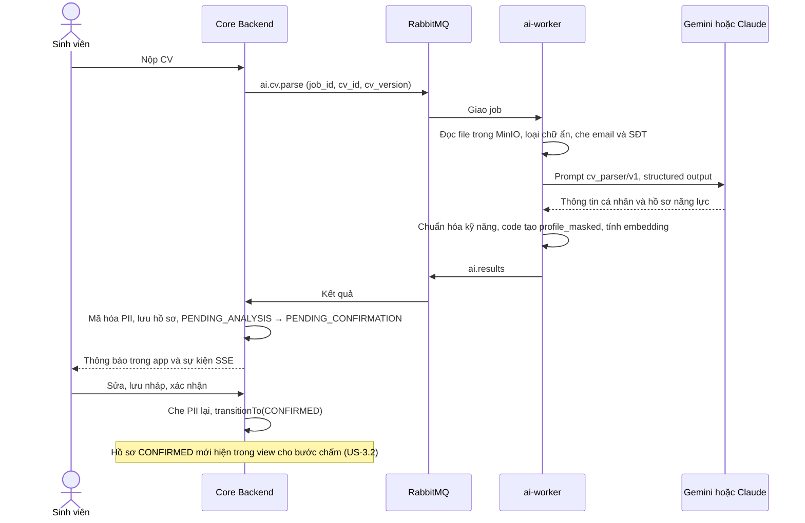
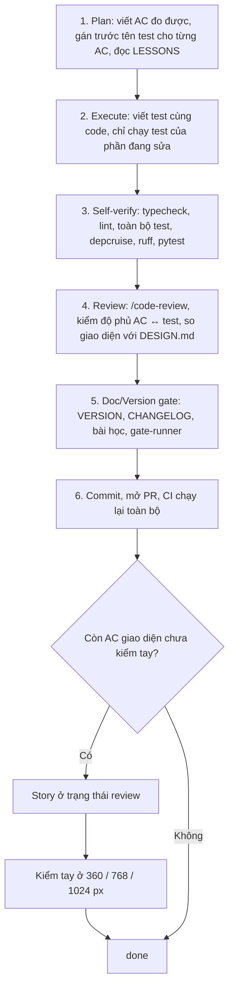

# Báo cáo tiến độ đồ án tốt nghiệp — Smart Recruit Match

| | |
|---|---|
| Sinh viên thực hiện | … |
| Giảng viên hướng dẫn | … |
| Ngày báo cáo | 30/10/2026 (tuần 4 trong lộ trình 13 tuần) |
| Kỳ báo cáo | Thứ Bảy 24/10 – Thứ Năm 29/10/2026 |
| Phiên bản hệ thống | 0.13.0 |
| Phạm vi | US-2.4, US-2.5, US-2.6, US-3.1; đóng 12 story đang chờ review |
| Mã nguồn | <https://github.com/PDTnhah/Smart-Recruit-Match>, nhánh `dev` (`main` có đến bản 0.12.0) |
| Báo cáo trước | [22/10/2026](2026-10-22-progress-report.md), bản 0.9.0 |

## Tóm tắt

- **Đã xong 13/37 story, tương đương 88/222 điểm (khoảng 40%).**
    - US-3.1 (5 điểm) đã merge, chỉ còn chờ kiểm tay giao diện. Tính cả story này là 93 điểm (khoảng 42%).
    - Lúc báo cáo 22/10: 1 story xong, 9 story chờ review, 67 điểm đã làm.
    - Tổng điểm tăng từ 217 lên 222 vì hai story được ước lượng lại khi bắt đầu: US-2.5 từ 5 lên 8, US-3.1 từ 3 lên 5.
- **Trong kỳ:**
    - Phát hành 4 phiên bản, từ 0.10.0 đến 0.13.0.
    - Làm xong 4 story mới, cộng 26 điểm.
    - Kiểm tay xong các AC còn treo, rồi chuyển 12 story từ `review` sang `done` (US-1.1, US-1.3…US-1.7, US-2.1…US-2.6).
    - Merge PR #13 đến #18. Nhánh `dev` merge vào `main` ngày 28/10.
- **So với lộ trình:**
    - Mốc M1 (hết tuần 4, 01/11) cần 64 điểm, đã xong 54. Còn thiếu US-5.1 (Allocation Engine) và US-6.4 (mô phỏng), tổng 10 điểm.
    - Giai đoạn 2 (mốc M2, hạn 15/11) đã xong sớm 4/6 story. US-3.1 đang review, còn US-6.2 (theo dõi chi phí LLM).
- **Hệ thống có thêm** ([mục 2](#2-hệ-thống-có-thêm-gì)):
    - AI đọc CV (PDF có chữ, PDF scan, DOCX) thành hồ sơ năng lực có cấu trúc. Chữ ẩn bị loại. Thông tin cá nhân được tách ra và mã hóa.
    - Danh mục kỹ năng chung gồm 174 kỹ năng. Tên kỹ năng trong CV và JD được quy về tên chuẩn. Quản trị duyệt kỹ năng mới.
    - Sinh viên xem file CV cạnh hồ sơ do AI trích xuất, sửa rồi xác nhận. Chỉ hồ sơ đã xác nhận mới được dùng để chấm.
    - Các hàm lọc điều kiện cứng, tính S_cv và lập shortlist. Các hàm này chưa được nối vào lô chấm; việc đó thuộc US-3.2.
- **Kiểm thử** ([mục 3](#3-quy-trình-kiểm-thử)):
    - 774 unit test qua lúc viết báo cáo; ngày 22/10 là 468.
    - 242 ca integration trong 33 file qua ở lần chạy cuối, ngày 28/10.

---

## 1. Đã làm gì từ 24/10 đến 29/10

### 1.1. Theo ngày

| Ngày | Việc | Phiên bản / PR |
|---|---|---|
| T7 24/10 | Không có commit | – |
| CN 25/10 | Chốt thiết kế: ma trận S_cv được đọc theo hai chiều (PRD GĐ3, thêm FR-38, CONTEXT D36). Đưa báo cáo 22/10 và tài liệu thiết kế sinh đề vào repo | docs |
| CN 25/10 | **US-2.4** CV Parser: loại chữ ẩn, tách thông tin cá nhân | 0.10.0, PR #13 |
| CN 25/10 | Giới hạn số worker Jest vì test làm hết RAM trên Windows. Giảm chi phí context của agent (CONTEXT D38). Sửa một test integration lúc qua lúc trượt (LESSONS §22) | chore, test |
| T3 27/10 | **US-2.5** Embedding và danh mục kỹ năng | 0.11.0, PR #14 |
| T3 27/10 | **US-2.6** Sinh viên xác nhận hồ sơ năng lực | 0.12.0, PR #15 |
| T4 28/10 | Chuyển 12 story sang `done`. Merge `dev` vào `main`. Cập nhật README | PR #16, #17 |
| T4 28/10 | **US-3.1** Lọc điều kiện cứng và công thức S_cv | 0.13.0 |
| T5 29/10 | Merge US-3.1 vào `dev` | PR #18 |

### 1.2. Các phiên bản trong kỳ

| Phiên bản | Ngày | Story | Điểm | Nội dung |
|---|---|---|---|---|
| 0.13.0 | 28/10 | US-3.1 | 5 | Lọc điều kiện cứng, tính S_cv bằng số nguyên, lập shortlist. 5 trọng số S_cv nằm trong cấu hình đợt. GPA dùng thang 4 |
| 0.12.0 | 27/10 | US-2.6 | 5 | Màn Hồ sơ: CV cạnh hồ sơ năng lực, sửa, lưu nháp, xác nhận, "Sửa lại". Backend che lại thông tin cá nhân mỗi lần lưu |
| 0.11.0 | 27/10 | US-2.5 | 8 | Danh mục kỹ năng, chuẩn hóa tên kỹ năng, embedding `bge-m3`, bảng `ai.embeddings` (pgvector), màn duyệt kỹ năng |
| 0.10.0 | 25/10 | US-2.4 | 8 | CV Parser, che và mã hóa thông tin cá nhân, trạng thái "Lỗi phân tích", trang "CV cần xử lý", điều khoản v2 |

Chi tiết từng phiên bản nằm ở [docs/CHANGELOG.md](../docs/CHANGELOG.md).

### 1.3. Trạng thái story

| Story | Trạng thái | Ghi chú |
|---|---|---|
| US-1.1, US-1.3…US-1.7, US-2.1…US-2.3 | `done` | Báo cáo 22/10 ghi 9 story này đang chờ CI và kiểm tay. Ngày 28/10 đã kiểm tay xong các AC còn lại |
| US-2.4, US-2.5, US-2.6 | `done` | Làm trong kỳ, đóng cùng ngày 28/10 |
| US-3.1 | `review` | Còn kiểm tay AC-13: form trọng số S_cv ở 360 / 768 / 1024 px |
| US-5.1, US-6.4 | `backlog` | Thuộc mốc M1 nhưng chưa bắt đầu |

---

## 2. Hệ thống có thêm gì

### 2.1. Mỗi vai trò làm thêm được gì

| Vai trò | Làm thêm được | Màn hình |
|---|---|---|
| Sinh viên | Đồng ý điều khoản v2. Nộp CV rồi theo dõi trạng thái "Đang phân tích", "Lỗi phân tích" hoặc "Sẵn sàng xác nhận"; trạng thái tự cập nhật. Xem file CV cạnh hồ sơ AI trích xuất, sửa từng phần, lưu nháp, xác nhận. Bấm "Sửa lại hồ sơ" khi cần sửa hồ sơ đã xác nhận | `/sv` › "Hồ sơ" |
| Cán bộ Trung tâm | Xem danh sách CV cần xử lý (phân tích lỗi hoặc có chữ ẩn), lọc theo đợt, mã SV, lý do; tải CV. Khi tạo đợt, nhập 5 trọng số S_cv | `/admin/cvs` "CV cần xử lý"; form "Đợt thực tập" |
| Quản trị hệ thống | Duyệt, gộp hoặc từ chối kỹ năng mới gặp trong CV và JD, xem kèm gợi ý của AI | `/admin/skills` "Danh mục kỹ năng" |
| HR doanh nghiệp | Kỹ năng trong yêu cầu JD được quy về tên chuẩn. Không nhập được hai tên của cùng một kỹ năng, ví dụ "React" và "React.js" | `/hr` › "JD của tôi" |
| Hệ thống (tự chạy) | Phân tích CV ngay khi SV nộp. Đưa kỹ năng mới vào hàng chờ, nhờ AI gợi ý tên chuẩn. Tính embedding cho hồ sơ | – |

### 2.2. Chi tiết theo story

**US-2.4: CV Parser (0.10.0).**

- **Ba loại file.**
    - PDF có chữ và DOCX: trích văn bản, loại chữ ẩn bằng bộ phát hiện đã có từ US-2.3.
    - PDF scan (không có lớp chữ, hoặc có ảnh mà phần chữ đọc được dưới 100 ký tự): gửi nguyên file PDF cho LLM, không cần OCR riêng.
    - Bản scan mà có chữ ẩn thì bị từ chối.
- **Che thông tin trước khi gửi LLM.** Email và số điện thoại được che bằng regex trước khi gửi.
- **Tách thông tin cá nhân (PII).**
    - LLM trả hai phần: thông tin cá nhân và hồ sơ năng lực. Thông tin cá nhân gồm họ tên, liên hệ, địa chỉ, ngày sinh, giới tính, quê quán, tôn giáo, tình trạng hôn nhân, có ảnh hay không.
    - **Code**, không phải LLM, tạo bản đã che `profile_masked` và văn bản CV đã che `masked_text`. Nếu còn sót giá trị cá nhân thì job lỗi `PII_MASK_FAILED`.
    - Core Backend mã hóa phần thông tin cá nhân bằng pgcrypto. Khóa chỉ có ở Core Backend. AI Service chỉ đọc được bản đã che, qua view.
- **Khi lỗi.** CV chuyển sang "Lỗi phân tích". SV nhận thông báo trong app và qua email, được mời tải lại. Trung tâm thấy CV ở trang "CV cần xử lý".
- **Điều khoản v2** ghi tên Gemini API của Google. Sinh viên mới chỉ đồng ý v1 phải đồng ý lại thì mới nộp được CV.

**US-2.5: Embedding và danh mục kỹ năng (0.11.0).**

- **Danh mục chung** `core.skills` gồm 174 kỹ năng IT kèm tên gọi khác (alias), chia 10 nhóm. Kỹ năng có trạng thái `PENDING → APPROVED | MERGED | REJECTED`; chuyển trạng thái qua `transitionTo`.
- **Chuẩn hóa tên kỹ năng không dùng LLM.** Thứ tự:
    1. So khóa tên (chữ thường, bỏ khoảng trắng và dấu `.`, `-`, `_`, `/`) với tên chuẩn hoặc alias. Nhờ vậy "ReactJS", "React.js", "react js" đều thành `React`.
    2. Không khớp thì so độ tương đồng embedding với danh mục. Cosine ≥ 0,85 thì gán.
    3. Còn lại giữ nguyên tên, đánh dấu "Kỹ năng mới" và đưa vào hàng chờ duyệt.
- **AI chỉ gợi ý.** Agent `skill_normalizer` gợi ý tên chuẩn, nhóm và kỹ năng có thể trùng. Quản trị quyết định; AI không tự thêm gì vào danh mục.
- **Embedding.** Mô hình `BAAI/bge-m3` tự host, vector 1024 chiều, lưu trong `ai.embeddings` (pgvector, index HNSW). Embedding của hồ sơ CV tính từ bản đã che, không từ PII. US-3.2, US-4.1, US-4.7 sẽ dùng lại.
- **Ngưỡng 0,85 được đo trên mô hình thật:** cặp kỹ năng khác nhau giống nhau nhất chỉ đạt 0,847; các cách viết khác của cùng một kỹ năng thì vượt ngưỡng, ví dụ ReactJS ~ React đạt 0,857.

**US-2.6: Sinh viên xác nhận hồ sơ năng lực (0.12.0).**

- **Màn Hồ sơ.**
    - Màn từ 1024 px: file CV và hồ sơ nằm thành hai cột. Màn nhỏ hơn: hai tab "CV" và "Hồ sơ năng lực". Đổi tab hay xoay máy không mất phần đang sửa.
    - Sửa từng phần: học vấn, kỹ năng, dự án, kinh nghiệm, ngoại ngữ, chứng chỉ. Ô kỹ năng gợi ý tên từ danh mục.
    - Hai nút "Lưu nháp" và "Xác nhận hồ sơ". Hồ sơ đã xác nhận thì chỉ đọc; muốn sửa thì bấm "Sửa lại hồ sơ".
- **Chỉ hồ sơ đã xác nhận mới vào view dữ liệu cho bước chấm.** Vì vậy đầu vào của Matching là dữ liệu SV đã tự kiểm.
- **Che lại thông tin cá nhân mỗi lần lưu.** SV có thể gõ tên hoặc số điện thoại vào phần mô tả dự án. Core Backend chạy bản viết lại bằng TypeScript của bộ che PII Python. Hai bản chạy chung một bộ 13 ca kiểm, nên kết quả che của hai phía luôn khớp nhau.
- **"Sửa lại"** tạo một phiên bản CV mới, chép lại hồ sơ và PII đã mã hóa, không gọi lại AI.
- **Chống ghi đè.** Hai tab cùng sửa thì tab lưu sau nhận `409` và được mời tải bản mới nhất.

**US-3.1: Lọc điều kiện cứng và công thức S_cv (0.13.0).**

Đây là phần tất định của GĐ3, viết thành hàm TypeScript thuần trong `apps/api/src/modules/matching/domain/`, không phụ thuộc DB hay LLM.

- **Lọc điều kiện cứng** (`checkHardFilters`): ngành, năm học tối thiểu, GPA tối thiểu, từng ngoại ngữ bắt buộc. Mỗi điều kiện không đạt cho đúng một mã lý do, kèm giá trị yêu cầu và giá trị thực tế. Đầu vào không có trường nhạy cảm nào (BR-03).
- **Đọc yêu cầu ngoại ngữ bằng code, không dùng LLM.**
    - Hiểu được TOEIC, IELTS, TOEFL iBT và ITP, JLPT, TOPIK, HSK, VSTEP/CEFR, "bậc 1–6".
    - Hiểu "hoặc" (đạt một trong các lựa chọn) và "và" (phải đạt hết).
    - Đọc được cách viết liền như "HSK5", "TOEIC650đ".
    - Hiện chỉ so chứng chỉ cùng loại, chưa quy đổi giữa các loại.
- **Tính S_cv** (`computeScv`) từ verdict từng tiêu chí do Matching Agent trả về.
    - 5 tiêu chí: kỹ năng bắt buộc, kỹ năng bổ trợ, dự án, học vấn, ngoại ngữ.
    - Tính bằng phân số số nguyên lớn, làm tròn một lần, trả về điểm ×100 dạng số nguyên. Ví dụ ở PRD cho đúng 58,80.
    - Verdict không có bằng chứng tính là `NOT_MET`. LLM không thêm, bỏ hay đổi trọng số kỹ năng được, vì kỹ năng được ghép theo yêu cầu JD.
    - JD không có tiêu chí nào đó (ví dụ không yêu cầu ngoại ngữ) thì trọng số của tiêu chí đó được chia lại cho các tiêu chí còn lại theo tỷ lệ.
- **Shortlist** (`selectShortlist`): giữ JD đủ điều kiện và có S_cv ≥ θ_cv, sắp giảm dần; bằng điểm thì xếp theo mã JD.
- **Trọng số trong cấu hình đợt.** 5 trọng số mặc định 0,40 / 0,15 / 0,20 / 0,15 / 0,10, tổng phải bằng 1, bị khóa sau khi mở đợt. Đổi trọng số chỉ cần tính lại, không phải gọi lại LLM (AD-2).
- **GPA dùng thang 4**, cùng thang với điều kiện GPA của JD.

### 2.3. Luồng CV từ lúc nộp đến lúc được dùng để chấm



Kết quả lỗi, kết quả thiếu hoặc không khớp CV thì CV chuyển sang `ANALYSIS_FAILED`. Kết quả trùng, kết quả của phiên bản cũ, hoặc kết quả cho CV đã thay bằng bản mới thì bị bỏ qua.

### 2.4. Dữ liệu, API, cấu hình mới

| Loại | Thêm trong kỳ |
|---|---|
| Bảng, cột | Bảng `core.skills`; bảng `ai.embeddings` (pgvector, mỗi loại đối tượng một index HNSW). Bảng `cvs` thêm `pii` (mã hóa), `masked_text`, nguồn, model và phiên bản prompt của lần phân tích, mã lỗi. CHECK GPA của `students` chỉ nhận 0–4 |
| View cho AI Service | `core.v_ai_skills`, `core.v_ai_skill_candidates`. `core.v_ai_cv_profile_masked` thêm `masked_text` |
| Migration | 9 file mới, từ `0011_cv_analysis` đến `0019_student_gpa_scale_4`; tổng cộng 20 file |
| Hàng đợi | `ai.skills.normalize` kèm `ai.skills.normalize.dlq` |
| Agent AI | `cv_parser` (prompt v1), `skill_normalizer` (prompt v1). Cả hai gọi LLM với `effort: low` |
| API | 10 endpoint mới, từ 38 lên 48. `GET /cvs` (Trung tâm); `GET`, `PUT /cvs/me/profile`, `PUT /cvs/me/profile/confirm`, `POST /cvs/me/profile/reopen`; `GET /skills`; `GET /admin/skills`, `POST /admin/skills/{id}/approve`, `/merge`, `/reject` |
| Biến môi trường | `PII_ENCRYPTION_KEY` (bắt buộc), `CV_MASK_CONTACTS`, `EMBEDDING_PROVIDER` (`hashing` mặc định hoặc `bge-m3`), `SKILL_MATCH_THRESHOLD`; volume `hf-models` lưu mô hình |
| Lệnh | `pnpm --filter @srm/api cv:redispatch` gửi lại job cho CV nộp trước 0.10.0 hoặc CV lỗi |

### 2.5. Thay đổi thiết kế từ báo cáo 22/10

Các điểm dưới đây spec còn để mở hoặc còn mâu thuẫn. Mỗi điểm đã được hỏi và chốt trước khi code, rồi ghi vào CONTEXT.

| Điểm | Trước | Hiện tại | Nguồn |
|---|---|---|---|
| Đọc ma trận S_cv | Chỉ theo sinh viên (shortlist). Trung tâm chỉ biết JD thiếu hồ sơ sau khi khóa nguyện vọng | Đọc thêm theo JD: Trung tâm xem CV phù hợp với từng JD và tỷ lệ CV phù hợp / chỉ tiêu, được cảnh báo ngay sau lượt chấm nếu tỷ lệ dưới 1. HR không xem được (BR-11). Thêm FR-38 | CONTEXT D36 |
| CV phân tích lỗi | Bảng chuyển trạng thái chưa có trạng thái lỗi; chưa có màn nào cho Trung tâm xem CV | Thêm trạng thái `ANALYSIS_FAILED` và trang "CV cần xử lý" | CONTEXT D37 |
| Che email, SĐT trước khi gửi LLM | ARCH ghi "có thể" | Bật mặc định, tắt được bằng `CV_MASK_CONTACTS` | CONTEXT D37 |
| PDF scan | Lớp gọi LLM chỉ gửi được văn bản | Gửi nguyên PDF cho LLM như tài liệu đính kèm, không cần OCR riêng | CONTEXT D37 |
| Điều khoản | v1 chỉ ghi tên Anthropic | v2 ghi thêm Google; SV phải đồng ý lại | CONTEXT D37 |
| Danh mục kỹ năng | Story đề xuất đặt trong module `matching` | Module riêng `skills`, vì hồ sơ SV và form JD cũng cần tra | CONTEXT D39 |
| Mô hình embedding trong compose | Chưa chốt có tải sẵn bge-m3 hay không | Mặc định `hashing` (giả, tất định), bge-m3 bật bằng `EMBEDDING_PROVIDER`, vì mô hình nặng và cần 2,5–3 GB RAM mỗi worker | CONTEXT D39 |
| Che PII khi SV sửa hồ sơ | ARCH chỉ đặt việc che PII ở AI Service | Core Backend che lại bằng bản TS, chạy chung bộ ca với bản Python | CONTEXT D40 |
| "Sửa lại" hồ sơ đã xác nhận | Spec chỉ nói cập nhật CV thì tạo phiên bản mới | Tạo phiên bản mới, chép hồ sơ, không gọi lại AI | CONTEXT D40 |
| Trọng số S_cv | PRD không có tham số wᵢ; ARCH ghi "theo trọng số của JD" | 5 trọng số trong cấu hình đợt, khóa sau khi mở đợt | CONTEXT D41 |
| Tiêu chí rỗng | PRD không nói trọng số của tiêu chí đó đi đâu | Chia lại cho các tiêu chí còn lại theo tỷ lệ | CONTEXT D41 |
| GPA | Sinh viên nhập thang 10, JD dùng thang 4 | Cùng thang 4. Migration `0019` xóa GPA lớn hơn 4 vì không quy đổi chính xác được | CONTEXT D41 |
| Ngoại ngữ bắt buộc | Chuỗi tự do ở cả JD và CV; không được dùng LLM cho điều kiện cứng | Code đọc chứng chỉ và điểm, chỉ so chứng chỉ cùng loại | CONTEXT D41 |
| Cách làm việc với agent | Mỗi story một phiên dài: 450–754 lượt, context trung bình 295–442 nghìn token mỗi lượt | Ba phiên mỗi story (Plan; Execute; Review và commit), có mục lục cho CONTEXT và LESSONS. Ước tính context mỗi lượt giảm 2–3 lần | CONTEXT D38 |

### 2.6. Chạy và demo phần mới

Cách dựng hệ thống và tạo dữ liệu demo giống [báo cáo 22/10, mục 2](2026-10-22-progress-report.md#2-chạy-hệ-thống-ở-local-bằng-docker). Có thêm hai bước:

1. Đặt `PII_ENCRYPTION_KEY` trong `deploy/.env`, giá trị dài ít nhất 32 ký tự, sinh bằng `openssl rand -base64 48`. Compose bắt buộc biến này cho `api`. Lưu bản sao khóa: mất khóa thì không giải mã được thông tin cá nhân đã lưu.
2. Build lại image: `docker compose -f deploy/docker-compose.yml up -d --build --wait`. Dịch vụ `migrate` tự chạy migration `0011`–`0019`.

Kịch bản demo (khoảng 5 phút):

1. **Trọng số S_cv.** Đăng nhập `center@srm.local`, mở đợt mẫu đang nháp. Nhóm "Trọng số điểm phù hợp CV (S_cv)" có giá trị mặc định. Sửa một ô cho tổng khác 1 thì lỗi hiện ở ô cuối. Mở đợt xong, cả nhóm chỉ đọc.
2. **Nộp CV.** Đăng nhập `sv001@srm.local`, đồng ý điều khoản v2, rồi tải lên một CV mẫu trong `ai-service/tests/fixtures/cv/`.
    - **Ở chế độ `fixture` (mặc định):** CV thật nào cũng phân tích lỗi. Màn hiện "Không phân tích được CV này"; Trung tâm thấy CV ở "CV cần xử lý". Chế độ này dùng để demo luồng lỗi.
    - **Khi bật Gemini** (`LLM_PROVIDER=gemini`, `GEMINI_API_KEY`, gói trả phí, CV giả): màn chuyển từ "Đang phân tích CV…" sang "Hồ sơ năng lực sẵn sàng để xác nhận" mà không cần tải lại. Sửa, lưu nháp, xác nhận, rồi thử "Sửa lại hồ sơ". Mẫu `cv_hidden_white.pdf` có chữ ẩn màu trắng; CV này bị gắn cờ và hiện trong danh sách của Trung tâm.
3. **Danh mục kỹ năng.** Đăng nhập `admin@srm.local`, vào "Danh mục kỹ năng" để duyệt, gộp hoặc từ chối kỹ năng mới. Ở chế độ `fixture`, cột gợi ý của AI có thể trống.
4. **Xem phía sau.** Trong PostgreSQL, cột `core.cvs.pii` chỉ là dữ liệu mã hóa. View `core.v_ai_cv_profile_masked` không có cột cá nhân nào.

---

## 3. Quy trình kiểm thử

### 3.1. Các tầng kiểm thử

| Tầng | Công cụ | Kiểm cái gì | Ví dụ trong kỳ |
|---|---|---|---|
| Unit | Jest (TS), pytest (Python) | Hàm thuần ở `domain/`, schema Zod, bảng chuyển trạng thái, quyết định áp kết quả AI | Lọc điều kiện cứng, đọc chứng chỉ ngoại ngữ, S_cv cho đúng 58,80 như ví dụ PRD |
| Property-based | fast-check | Tính chất phải đúng với mọi đầu vào sinh ngẫu nhiên | S_cv luôn trong 0–100; nâng verdict thì S_cv không giảm; cùng đầu vào thì cùng kết quả |
| Integration | Jest + testcontainers | Chạy trên PostgreSQL (có pgvector), Redis, RabbitMQ, MinIO thật trong Docker: phân quyền, giao dịch, ràng buộc DB, job AI đi trọn vòng | Mã hóa và giải mã PII; audit không chứa PII; sửa hồ sơ trả `409` khi lệch `row_version`; SV khác nhận `404` |
| AI Service | pytest, LLM ở chế độ `fixture` | Agent, bộ phát hiện chữ ẩn, bộ che PII, chuẩn hóa kỹ năng, worker (idempotent, thử lại, DLQ) | CV mẫu tổng hợp: có chữ ẩn, nằm ngoài trang, bản scan, bản scan có watermark |
| Mô hình thật | `pytest -m slow` | Chạy với bge-m3 thật, mặc định bỏ qua vì cần tải mô hình 4,5 GB | Đo ngưỡng 0,85 cho chuẩn hóa kỹ năng |
| Gọi API LLM thật | `ai-service/evals/smoke_llm.py`, `perf_cv_parse.py` | Chạy tay với key thật và dữ liệu giả, không chạy trong CI | Smoke test phân tích CV; đo thời gian phân tích (NFR-6) |
| Kiểm tay giao diện | Trình duyệt, theo `DESIGN.md` | Bố cục ở 360 / 768 / 1024 px, bốn trạng thái của mỗi màn (đang tải, rỗng, lỗi, có dữ liệu), chuỗi tiếng Việt | Màn Hồ sơ hai cột hoặc hai tab; form trọng số S_cv |
| Kiểm cấu trúc | dependency-cruiser, các script so khớp | Ranh giới module; schema DB khớp migration; hợp đồng TS khớp Python; client của web khớp API | `domain/` của `matching` không import NestJS hay Drizzle |

**Quy tắc riêng cho phần AI:**

- **Test không bao giờ gọi API LLM thật.** `conftest.py` xóa key và chặn mọi kết nối mạng ra ngoài. LLM chạy ở chế độ `fixture`, trả phản hồi đã ghi sẵn.
- **Bộ ca dùng chung cho hai ngôn ngữ.** Bộ che PII có bản Python và bản TypeScript; cả hai chạy cùng file `pii-mask-cases.json` (13 ca). Hàm khóa tên kỹ năng cũng vậy. Sửa một phía mà quên phía kia thì test báo lỗi.
- **Ngưỡng phải đo bằng số liệu, không đặt theo cảm tính**, như ngưỡng cosine 0,85 ở US-2.5.

### 3.2. Kiểm thử trong vòng đời một story



1. **Plan.** Mỗi AC phải đo được. Ngay từ đầu, file story có bảng *Verification commands* ghi test nào chứng minh AC nào. Đọc mục lục LESSONS để tránh bẫy đã gặp.
2. **Execute.** Viết test cùng lúc với code. Trong lúc làm chỉ chạy test của phần đang sửa, ví dụ:

    ```bash
    pnpm --filter @srm/api exec jest --testPathPatterns 'modules/matching/domain' --selectProjects unit
    ```

3. **Self-verify.** Dừng Docker Compose trước để máy không hết RAM (LESSONS §15), rồi chạy:

    ```bash
    pnpm typecheck && pnpm lint && pnpm test && pnpm depcruise
    ai-service/.venv/Scripts/ruff check ai-service && ai-service/.venv/Scripts/pytest ai-service
    ```

4. **Review.** `/code-review` tìm lỗi logic. Skill koni-qc kiểm mỗi AC đã có ca dương, ca âm và ca biên chưa. Giao diện được so với `DESIGN.md`.
5. **Doc/Version gate.** `sh .koni-harness/gate-runner.sh --phase release-commit` chặn commit khi: version không khớp, CHANGELOG thiếu mục, story thiếu kết luận bài học, story có giao diện mà thiếu dòng `Design applied`. Phase `pre-push` của cùng script chạy `pnpm test` và quét secret; hiện chạy tay, chưa cài thành git hook.
6. **CI.** Mỗi lần push, GitHub Actions chạy lại toàn bộ ([mục 3.4](#34-cổng-ci)).
7. **Kiểm tay.** Story có giao diện ở trạng thái `review` cho tới khi kiểm tay xong ở ba cỡ màn hình. US-3.1 đang ở bước này.

### 3.3. Truy vết từ AC đến test

Tên test ghi mã quy tắc (BR-xx), giai đoạn (GĐx) hoặc quyết định kiến trúc (AD-x), để khi viết báo cáo đồ án thì truy được quy tắc nào được test nào kiểm. Trích bảng của US-3.1:

| AC | Test |
|---|---|
| AC-1 | `hard-filter.spec.ts` › `GĐ3 hard filter: each failed condition yields one reason code` |
| AC-2 | `hard-filter.spec.ts` › `BR-03 hard filter facts reject sensitive fields (strict schema)` |
| AC-4 | `scv.spec.ts` › `GĐ3 S_cv: PRD sample output yields 58.80 with default weights` |
| AC-6 | `scv.spec.ts` › `AD-2 S_cv recomputes from stored criteria when weights change` |
| AC-7 | `scv.property.spec.ts` › `GĐ3 AD-2 S_cv bounded, monotonic and deterministic` |
| AC-11 | Không file nào trong `matching/domain` import `@nestjs` hay `drizzle-orm`; `pnpm depcruise` xanh |
| AC-13 | `campaign.spec.ts` › `GĐ0 S_cv weights default and sum error shows with other errors`, cộng kiểm tay form ở 3 cỡ màn hình |

### 3.4. Cổng CI

Mỗi push và PR chạy hai job trên GitHub Actions. Một bước lỗi là cả job lỗi.

| Job | Bước | Bắt được lỗi gì |
|---|---|---|
| TypeScript | `pnpm typecheck` | Sai kiểu ở mọi package |
| | Sinh lại migration, so với bản đã commit | Sửa schema DB mà quên tạo migration |
| | Sinh lại OpenAPI và client của web | Đổi endpoint mà web vẫn dùng kiểu cũ |
| | Sinh lại hợp đồng Zod → JSON Schema → Pydantic | Hợp đồng message giữa TS và Python lệch nhau, hoặc file sinh ra bị sửa tay |
| | `pnpm lint` | Vi phạm ESLint |
| | `pnpm test` | Unit và integration (testcontainers dùng Docker của runner) |
| | Build web | Lỗi build Vite |
| | `pnpm depcruise`, `pnpm depcruise:fixture` | Module truy vấn bảng của module khác, `domain/` import framework; kiểm luôn rằng bộ luật vẫn bắt được vi phạm mẫu |
| AI Service | `ruff check`, `pytest` | Lint Python và test; CI không có key LLM |

### 3.5. Kết quả hiện tại

| Loại | 22/10 | 29/10 | Tăng | Chạy bằng |
|---|---|---|---|---|
| Unit `packages/shared` | 141 | 220 | +79 | `pnpm --filter @srm/shared test` |
| Unit `apps/api` | 153 | 254 | +101 | `pnpm --filter @srm/api test:unit` |
| Integration `apps/api` | khoảng 200, 30 file | 242, 33 file | khoảng +42 | `pnpm test`, cần Docker |
| `ai-service` (pytest) | 174 | 300, cộng 2 test `slow` | +126 | `ai-service/.venv/Scripts/pytest ai-service` |
| **Tổng** | khoảng 668 | 1016 | khoảng +348 | |

- 774 unit test (220 + 254 + 300) chạy lại và qua hết lúc viết báo cáo, ngày 29/10.
- Báo cáo này không chạy lại 242 ca integration. Lần chạy cuối là lúc đóng US-3.1 ngày 28/10: API qua 496 ca (254 unit và 242 integration). CI chạy lại bộ này trên mỗi push.
- Web vẫn chưa có test component. Schema mà form dùng có unit test ở `packages/shared`; giao diện được kiểm tay.

### 3.6. Lỗi tìm ra nhờ test và review trong kỳ

Mỗi bẫy được ghi vào [docs/LESSONS.md](../docs/LESSONS.md) để story sau không gặp lại.

| Mục | Lỗi | Cách phát hiện | Cách sửa |
|---|---|---|---|
| LESSONS §15 | Windows hết bộ nhớ ảo (RAM + pagefile) khi chạy cả bộ test: Jest mặc định mở 13 worker, mỗi file integration dựng thêm app Nest | Nhiều suite đỏ ngẫu nhiên, Node báo `out of memory` | Giới hạn 4 worker và giới hạn bộ nhớ mỗi worker; dừng compose trước khi chạy cả bộ |
| LESSONS §22 | Test outbox email lúc qua lúc trượt: các file integration dùng chung DB, mà từ US-2.3 thông báo gửi tới mọi tài khoản Trung tâm, nên lọt sang test khác | Test trượt ngẫu nhiên khi chạy cả bộ, chạy riêng thì xanh | Test chỉ đọc thông báo theo đúng loại mình tạo |
| LESSONS §24 | Index HNSW của pgvector lọc sau khi quét, nên vector cũ (kỹ năng đã gộp, model cũ) chiếm chỗ ứng viên và truy vấn trả thiếu. Test không bắt được vì danh mục test nhỏ | Review US-2.5 | Mỗi loại đối tượng một index riêng; xóa vector cũ ngay khi ghi bản mới |
| LESSONS §25 | Form gửi `row_version` của dữ liệu vừa tải lại qua SSE, không phải của dữ liệu lúc mở form, nên khóa lạc quan mất tác dụng và có thể ghi đè thay đổi từ tab khác | Review US-2.6 | Form giữ `row_version` của lần nạp, chỉ cập nhật sau khi lưu hoặc khi người dùng tải lại |
| LESSONS §26 | Lỗi "tổng phải bằng 1" vẫn hiện sau khi người dùng sửa ô khác cho tổng đúng | `/code-review` US-3.1 | Các ô của tổng kiểm lại ô mang lỗi mỗi khi thay đổi |
| US-3.1 | Bộ đọc yêu cầu ngoại ngữ hiểu sai "hoặc" / "và", cách viết liền ("HSK5"), ngôn ngữ ngoài bảng | `/code-review` US-3.1 | Sửa luật đọc và thêm test cho từng trường hợp |

---

## 4. Việc tiếp theo

**Còn chờ**

- US-3.1: kiểm tay form trọng số S_cv ở 360 / 768 / 1024 px, rồi đóng story.
- Merge `dev` vào `main` để `main` có bản 0.13.0.

**Bước tiếp theo**

- **Hoàn thành mốc M1** (hạn 01/11): US-5.1 (Allocation Engine và property-based test cho ba tính chất ổn định, không vượt sức chứa, tất định) và US-6.4 (mô phỏng so với các phương án đối chứng).
- **US-3.2: Matching Agent chạy hàng loạt.** Nối các hàm của US-3.1 vào lô chấm; kiểm trích dẫn bằng RapidFuzz (≥ 85); lọc sơ bộ bằng embedding.
- **US-6.2: Theo dõi chi phí LLM**, để đóng mốc M2.

**Giới hạn hiện tại**

- **Mặc định chưa gọi LLM thật.** Compose để `LLM_PROVIDER=fixture`, nên CV thật nào cũng phân tích lỗi. Muốn phân tích CV thật phải dùng Gemini gói trả phí; free tier chỉ dùng với dữ liệu giả.
- **Mặc định chưa chạy bge-m3.** Compose dùng embedding giả `hashing`. Bật bge-m3 cần build lại image và 2,5–3 GB RAM cho mỗi bản sao `ai-worker`.
- **Dữ liệu cũ.** CV phân tích trước 0.11.0 không được chuẩn hóa kỹ năng lại và chưa có embedding. GPA nhập theo thang 10 đã bị xóa, phải nhập lại.
- **Xóa file khi hết hạn lưu (NFR-2)** phải đếm tham chiếu trước, vì sau "Sửa lại" hai phiên bản CV dùng chung một file.
- **Chưa có màn quản trị** cho tài khoản và hàng đợi lỗi (DLQ).

**Điểm cần xin ý kiến thầy/cô**

- **FR-38** (Trung tâm xem CV phù hợp theo từng JD, cảnh báo JD có tỷ lệ CV phù hợp / chỉ tiêu dưới 1) đã có trong PRD nhưng chưa có story nào nhận. CONTEXT D36 đề xuất đưa phần cảnh báo sớm vào US-3.4 và màn xem theo JD vào dashboard US-6.1.
- **Quy đổi chứng chỉ ngoại ngữ.** Hiện chỉ so chứng chỉ cùng loại, ví dụ JD yêu cầu TOEIC 600 thì SV có IELTS 6.5 không được tính là đạt. Có cần bảng quy đổi giữa các loại chứng chỉ không, và nếu cần thì lấy theo nguồn nào?
